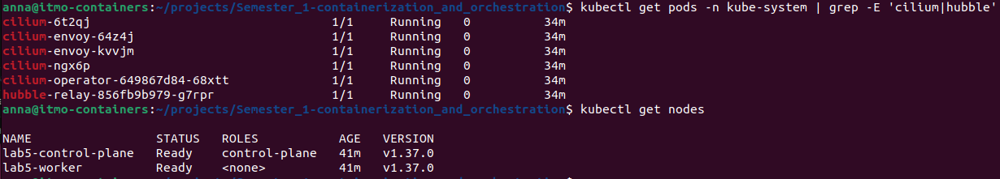
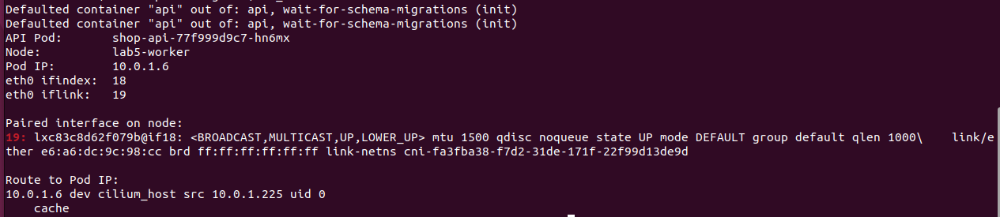
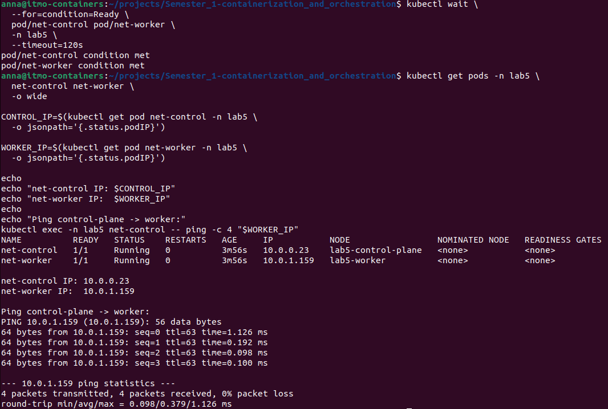

# Лабораторная работа №5 - Zero-trust сеть с доказательством

## Часть 0 - Выбор CNI

Для лабораторной работы выбран CNI-плагин `Cilium`.

Стандартный CNI `kindnet`, используемый в kind по умолчанию, не подходит для этой лабораторной работы, поскольку он не обеспечивает необходимую поддержку Kubernetes NetworkPolicy.

В качестве вариантов рассматривались `Cilium` и `Calico`. Оба CNI поддерживают сетевые политики, однако для данной работы выбран `Cilium` по следующим причинам:

- Cilium использует eBPF для обработки сетевого трафика и применения политик;
- поддерживает стандартные Kubernetes NetworkPolicy;
- предоставляет Hubble для наблюдения за сетевыми соединениями между Pod-ами;
- Hubble будет полезен в Части 6 для поиска намеренно внесенной ошибки связности.

Таким образом, Cilium позволяет не только реализовать zero-trust политики, но и наблюдать фактический сетевой трафик, что соответствует задачам лабораторной работы.

Для проверки Cilium был установлен в кластер kind с отключенным стандартным CNI.

```bash
kubectl get pods -n kube-system | grep -E 'cilium|hubble'
kubectl get nodes
```

На каждой ноде запущен агент Cilium, а обе ноды находятся в состоянии `Ready`. Дополнительно включен `Hubble Relay`, который далее будет использоваться для наблюдения за сетевыми соединениями и диагностики сетевых политик.
<details>
<summary>Результат</summary>


</details>

## Часть 1 - Развертывание shop и исследование сети Pod-а

Приложение `shop` было развернуто в kind-кластере с Cilium в качестве CNI. В namespace `lab5` запущены сервисы `api`, `worker` и PostgreSQL.

Для исследования сети был выбран один из Pod-ов `api`.

Pod имеет следующие параметры:

```text
Node:   lab5-worker
Pod IP: 10.0.1.6
```

Параметры интерфейса `eth0` были получены через sysfs контейнера:

```bash
kubectl exec -n lab5 "$API_POD" -- cat /sys/class/net/eth0/ifindex
kubectl exec -n lab5 "$API_POD" -- cat /sys/class/net/eth0/iflink
```

Получены следующие значения:

```text
ifindex: 18
iflink:  19
```

Значение `iflink` указывает индекс парного сетевого интерфейса на ноде.

Парный интерфейс на worker-ноде был найден по значению `iflink`:

```bash
docker exec lab5-worker ip -o link | grep '^19:'
```

На ноде `lab5-worker` был найден соответствующий интерфейс:

```text
19: lxc83c8d62f079b@if18
```

Таким образом, интерфейс `eth0` внутри Pod-а и интерфейс `lxc83c8d62f079b` на ноде образуют veth-пару.

Маршрут до IP Pod-а на ноде:

```bash
docker exec lab5-worker ip route get 10.0.1.6
```

Результат:

```text
10.0.1.6 dev cilium_host src 10.0.1.225
```

Это показывает, что обработка трафика Pod-а на стороне ноды выполняется через сетевой datapath Cilium.
<details>
<summary>Результат</summary>


</details>

Для проверки прямой связности Pod-ов на разных нодах были созданы два тестовых Pod-а:

```text
net-control   10.0.0.23    lab5-control-plane
net-worker    10.0.1.159   lab5-worker
```

Из Pod-а `net-control` был выполнен `ping` напрямую по Pod IP второго Pod-а:

```text
PING 10.0.1.159
4 packets transmitted, 4 packets received, 0% packet loss
```

Таким образом, Pod-ы, расположенные на разных Kubernetes-нодах, могут напрямую взаимодействовать по Pod IP. Маршрутизацию между ними обеспечивает установленный CNI Cilium.
<details>
<summary>Результат</summary>


</details>

## Часть 2 - Докажи непрерывность через хаос подов
Реализуем доступ к приложению `api` через `NodePort` сервиса [install/templates/api-service.yaml](install/templates/api-service.yaml):
```yaml
spec:
  type: {{ .Values.api.service.type }}
  selector: # на какие Pod-ы применяется сетевая настройка сервиса
    app.kubernetes.io/name: shop-api
    app.kubernetes.io/instance: {{ .Release.Name }}
  ports:
    - name: http
      port: {{ .Values.api.service.port }}
      targetPort: http
      {{- if eq .Values.api.service.type "NodePort" }}
      nodePort: {{ .Values.api.service.nodePort }}
      {{- end }}
```
В [install/values.yaml](install/values.yaml) укажем доступ к `api` на порту `api.service.nodePort=30082`. Обновим `helm`-релиз и посмотрим настройки сервиса `api`:
```bash
pona@pona-RedmiBook-14:~/Documents/Semester_1-containerization_and_orchestration$ kubectl --context kind-lab5 describe service shop-api -n lab5
Name:                     shop-api
Namespace:                lab5
Labels:                   app.kubernetes.io/instance=shop
                          app.kubernetes.io/managed-by=Helm
                          app.kubernetes.io/name=shop-api
Annotations:              meta.helm.sh/release-name: shop
                          meta.helm.sh/release-namespace: lab5
                          prometheus.io/path: /metrics
                          prometheus.io/port: 8080
                          prometheus.io/scrape: true
Selector:                 app.kubernetes.io/instance=shop,app.kubernetes.io/name=shop-api
Type:                     NodePort
IP Family Policy:         SingleStack
IP Families:              IPv4
IP:                       10.96.19.73
IPs:                      10.96.19.73
Port:                     http  8080/TCP
TargetPort:               http/TCP
NodePort:                 http  30082/TCP
Endpoints:                10.244.1.47:8080,10.244.1.2:8080,10.244.1.75:8080 + 1 more...
Session Affinity:         None
External Traffic Policy:  Cluster
Internal Traffic Policy:  Cluster
Events:                   <none>
```
Видим что `External Traffic Policy` - Cluster, соответственно вне зависимости от того, на какую ноду приходит запрос он будет перенаправлен на под любой другой ноды. Проверим это на примере запроса `GET /health` `api`: посмотрим, на какие ноды установлены все реплики `api`, отправим запрос через `NodePort` на обе ноды кластера:
```bash
pona@pona-RedmiBook-14:~/Documents/Semester_1-containerization_and_orchestration$ kubectl --context kind-lab5 get pods \
  --namespace lab5 \
  --selector app.kubernetes.io/part-of=shop \
  -o wide
NAME                              READY   STATUS      RESTARTS   AGE   IP             NODE          NOMINATED NODE   READINESS GATES
shop-api-77f999d9c7-48c55         1/1     Running     0          65m   10.244.1.47    lab5-worker   <none>           <none>
shop-api-77f999d9c7-b9cr9         1/1     Running     0          65m   10.244.1.97    lab5-worker   <none>           <none>
shop-api-77f999d9c7-wfq8m         1/1     Running     0          65m   10.244.1.75    lab5-worker   <none>           <none>
shop-api-77f999d9c7-xffxf         1/1     Running     0          65m   10.244.1.2     lab5-worker   <none>           <none>
shop-postgres-1                   1/1     Running     0          64m   10.244.1.50    lab5-worker   <none>           <none>
shop-schema-migration-1-0-2cj6m   0/1     Completed   0          65m   10.244.1.209   lab5-worker   <none>           <none>
shop-worker-6d45dc5667-jl8cz      1/1     Running     0          65m   10.244.1.225   lab5-worker   <none>           <none>
shop-worker-6d45dc5667-n6kh7      1/1     Running     0          65m   10.244.1.239   lab5-worker   <none>           <none>
pona@pona-RedmiBook-14:~/Documents/Semester_1-containerization_and_orchestration$ kubectl --context kind-lab5 get nodes -o wide
NAME                 STATUS   ROLES           AGE   VERSION   INTERNAL-IP   EXTERNAL-IP   OS-IMAGE                       KERNEL-VERSION              CONTAINER-RUNTIME
lab5-control-plane   Ready    control-plane   89m   v1.37.0   172.18.0.2    <none>        Debian GNU/Linux 13 (trixie)   6.8.0-138-generic (amd64)   containerd://2.3.4
lab5-worker          Ready    <none>          89m   v1.37.0   172.18.0.3    <none>        Debian GNU/Linux 13 (trixie)   6.8.0-138-generic (amd64)   containerd://2.3.4
pona@pona-RedmiBook-14:~/Documents/Semester_1-containerization_and_orchestration$ curl --noproxy '*' http://172.18.0.3:30082/health
ok
pona@pona-RedmiBook-14:~/Documents/Semester_1-containerization_and_orchestration$ curl --noproxy '*' http://172.18.0.2:30082/health
ok
```
Видим что все реплики `api` установлены на ноду `lab5-worker`, но запрос, направленный на `lab5-control-plane` так же успешно проходит и перенаправляется на нужный сервис.

`NodePort` и `LoadBalancer` - это типы сервисов для доступа извне к приложениям, развернутым в Kubernetes. Тип сервиса `NodePort` не является целевым при поднятии приложения в продакшене, поскольку зависит от ip-адреса виртуальной машины, при изменении которого доступ к приложению через `NodePort` будет потерян, так как внешний пользователь не узнает о смене ip-адреса. Для решения этой проблемы используется тип сервисов `LoadBalancer`, который предоставляет доступ к приложениям через отдельный внешний IP или DNS, не зависящий от адреса ноды.

В скрипте [run-load-client.sh](run-load-client.sh) описан запуск контейнера `load-client`, отправляющий на `api` запросы `GET /health` с частотой `5rps` и публикующий метрику `load_client_requests_total` в `prometheus`. Данная метрика потребуется для построения графика ошибок при удалении подов `api` из кластера.

Также реализуем скрипт [chaos-api-pods.sh](chaos-api-pods.sh), который раз в INTERVAL_SECONDS убивает случайный под `shop-api`. Поскольку `shop-api` поднимается достаточно долго (порядка 15 секунд) выберем INTERVAL_SECONDS = 20, чтобы не убить все работающие поды `api` до их поднятия. 

Подадим нагрузку на сервис, подождем ее стабилизации и запустим скрипт удаления подов и посмотрим на график ошибок.
<details>
<summary>График ошибок GET /health контейнера нагрузки</summary>


</details>


<details>
<summary>Результат удаления подов shop-api</summary>

```bash
pona@pona-RedmiBook-14:~/Documents/Semester_1-containerization_and_orchestration$ INTERVAL_SECONDS=20 KUBE_CONTEXT=kind-lab5 NAMESPACE=lab5 RELEASE=shop ./lab5/chaos-api-pods.sh
Starting API pod chaos.
Context:  kind-lab5
Namespace: lab5
Selector:  app.kubernetes.io/name=shop-api,app.kubernetes.io/instance=shop
Interval:  20s
Press Ctrl+C to stop.
2026-10-11T17:13:00+03:00 Deleting pod shop-api-77f999d9c7-g9tdh
pod "shop-api-77f999d9c7-g9tdh" deleted from lab5 namespace
2026-10-11T17:13:20+03:00 Deleting pod shop-api-77f999d9c7-bzn76
pod "shop-api-77f999d9c7-bzn76" deleted from lab5 namespace
2026-10-11T17:13:40+03:00 Deleting pod shop-api-77f999d9c7-bmhqm
```
</details>
<details>
<summary>Изменение состояния подов shop-api</summary>

```bash
pona@pona-RedmiBook-14:~/Documents/Semester_1-containerization_and_orchestration$ kubectl --context kind-lab5 get pods   --namespace lab5   --selector app.kubernetes.io/name=shop-api   --watch   --output-watch-events   --output custom-columns='EVENT:.type,POD:.object.metadata.name,PHASE:.object.status.phase,IP:.object.status.podIP,NODE:.object.spec.nodeName'
EVENT   POD                         PHASE     IP             NODE
ADDED   shop-api-77f999d9c7-5qmxz   Running   10.244.1.37    lab5-worker
ADDED   shop-api-77f999d9c7-bzn76   Running   10.244.1.200   lab5-worker
ADDED   shop-api-77f999d9c7-g9tdh   Running   10.244.1.103   lab5-worker
ADDED   shop-api-77f999d9c7-m2fm8   Running   10.244.1.218   lab5-worker
MODIFIED   shop-api-77f999d9c7-g9tdh   Running   10.244.1.103   lab5-worker
ADDED      shop-api-77f999d9c7-xzb4k   Pending   <none>         <none>
MODIFIED   shop-api-77f999d9c7-g9tdh   Running   10.244.1.103   lab5-worker
MODIFIED   shop-api-77f999d9c7-xzb4k   Pending   <none>         lab5-worker
MODIFIED   shop-api-77f999d9c7-xzb4k   Pending   <none>         lab5-worker
MODIFIED   shop-api-77f999d9c7-xzb4k   Pending   <none>         lab5-worker
MODIFIED   shop-api-77f999d9c7-g9tdh   Failed    10.244.1.103   lab5-worker
MODIFIED   shop-api-77f999d9c7-xzb4k   Pending   10.244.1.33    lab5-worker
MODIFIED   shop-api-77f999d9c7-g9tdh   Failed    10.244.1.103   lab5-worker
MODIFIED   shop-api-77f999d9c7-g9tdh   Failed    10.244.1.103   lab5-worker
DELETED    shop-api-77f999d9c7-g9tdh   Failed    10.244.1.103   lab5-worker
MODIFIED   shop-api-77f999d9c7-xzb4k   Pending   10.244.1.33    lab5-worker
MODIFIED   shop-api-77f999d9c7-xzb4k   Running   10.244.1.33    lab5-worker
MODIFIED   shop-api-77f999d9c7-bzn76   Running   10.244.1.200   lab5-worker
ADDED      shop-api-77f999d9c7-bmhqm   Pending   <none>         <none>
MODIFIED   shop-api-77f999d9c7-bzn76   Running   10.244.1.200   lab5-worker
MODIFIED   shop-api-77f999d9c7-bmhqm   Pending   <none>         lab5-worker
MODIFIED   shop-api-77f999d9c7-bmhqm   Pending   <none>         lab5-worker
MODIFIED   shop-api-77f999d9c7-bmhqm   Pending   <none>         lab5-worker
MODIFIED   shop-api-77f999d9c7-bzn76   Failed    10.244.1.200   lab5-worker
MODIFIED   shop-api-77f999d9c7-bmhqm   Pending   10.244.1.49    lab5-worker
MODIFIED   shop-api-77f999d9c7-bzn76   Failed    10.244.1.200   lab5-worker
MODIFIED   shop-api-77f999d9c7-bzn76   Failed    10.244.1.200   lab5-worker
DELETED    shop-api-77f999d9c7-bzn76   Failed    10.244.1.200   lab5-worker
MODIFIED   shop-api-77f999d9c7-bmhqm   Pending   10.244.1.49    lab5-worker
MODIFIED   shop-api-77f999d9c7-bmhqm   Running   10.244.1.49    lab5-worker
MODIFIED   shop-api-77f999d9c7-xzb4k   Running   10.244.1.33    lab5-worker
```
</details>
Видим что после удаления подов ip адреса новых подов меняются:
- БЫЛО: к поду `shop-api-77f999d9c7-g9tdh` можно обратиться по адресу `10.244.1.103`
- СТАЛО: под `shop-api-77f999d9c7-g9tdh` удален, заместо него создан под `shop-api-77f999d9c7-xzb4k`, к которому можно обратиться по адресу `10.244.1.33`

Таким образом подам при создании присваивается новый ip-адрес, уникальный для всего кластера. По данному ip-адресу поды могут общаться между собой, образуя плоскую сеть Kubernetes. Сервис `api-service` предоставляет виртуальный адрес `ClusterIp`, по которому к `shop-api` могут обращаться другие поды из кластера. `ClusterIp` не зависит от создания/удаления подов, к которым он привязан. `CoreDNS` в свою очередь предоставляем маппинг имени сервиса `shop-api.lab5.svc.cluster.local` -> `ClusterIp`. 

Сервис `api-service` при пересоздании пода продолжает жить, следовательно `ClusterIp` при удалении пода не меняется и запрос по DNS имени `shop-api.lab5.svc.cluster.local` будет корректно перенаправляться на хотя бы 1 работающий под `shop-api`.

`EndpointSlice` содержит актуальный список ip-адресов всех подов для сервиса, прошедших `readiness`-пробу. 

Проверим режим работы `kube-proxy`:
```bash
pona@pona-RedmiBook-14:~/Documents/Semester_1-containerization_and_orchestration$ kubectl --context kind-lab5 get configmap kube-proxy \
  --namespace kube-system \
  -o jsonpath='{.data.config\.conf}' \
  | grep '^mode:'
mode: iptables
```
Таким образом, режим работы `kube-proxy` - `iptables`. В данном режиме на каждой ноде создаются правила, отвечающие за маршрутизацию трафика, поступающего на `CluaterIp`. В режиме `IPVS` для маршрутизации трафика используется механизм виртуальных серверов ядра Linux, основанный на хэш-таблицах. Данный режим больше подходит для кластеров с большим количеством сервисов, так как значительно быстрее "ищет" нужный под для обработки запроса.

## Часть 3 - Спроектируй целевую матрицу доступа
Для начала получим список всех подов кластера:
<details>
<summary>Результат</summary>

```bash
pona@pona-RedmiBook-14:~/Documents/Semester_1-containerization_and_orchestration$ kubectl --context kind-lab5 get pods --all-namespaces
NAMESPACE            NAME                                                 READY   STATUS      RESTARTS   AGE
cnpg-system          cnpg-cloudnative-pg-7b5f5d7b65-9zr45                 1/1     Running     0          3h29m
kube-system          cilium-2hxwn                                         1/1     Running     0          3h40m
kube-system          cilium-envoy-85c7q                                   1/1     Running     0          3h40m
kube-system          cilium-envoy-cjwxc                                   1/1     Running     0          3h40m
kube-system          cilium-operator-649867d84-7d87l                      1/1     Running     0          3h40m
kube-system          cilium-operator-649867d84-wpwrh                      1/1     Running     0          3h40m
kube-system          cilium-tds8f                                         1/1     Running     0          3h40m
kube-system          coredns-559f6c778d-g9mfh                             1/1     Running     0          3h50m
kube-system          coredns-559f6c778d-w8bzh                             1/1     Running     0          3h50m
kube-system          etcd-lab5-control-plane                              1/1     Running     0          3h50m
kube-system          hubble-relay-856fb9b979-nmlbk                        1/1     Running     0          3h40m
kube-system          kube-apiserver-lab5-control-plane                    1/1     Running     0          3h50m
kube-system          kube-controller-manager-lab5-control-plane           1/1     Running     0          3h50m
kube-system          kube-proxy-m9kr8                                     1/1     Running     0          3h50m
kube-system          kube-proxy-v8nx2                                     1/1     Running     0          3h50m
kube-system          kube-scheduler-lab5-control-plane                    1/1     Running     0          3h50m
lab5                 shop-api-77f999d9c7-6kjnx                            1/1     Running     0          40m
lab5                 shop-api-77f999d9c7-f29kl                            1/1     Running     0          40m
lab5                 shop-api-77f999d9c7-gph79                            1/1     Running     0          40m
lab5                 shop-api-77f999d9c7-tcgj9                            1/1     Running     0          39m
lab5                 shop-postgres-1                                      1/1     Running     0          3h26m
lab5                 shop-schema-migration-1-0-2cj6m                      0/1     Completed   0          3h28m
lab5                 shop-worker-6d45dc5667-jl8cz                         1/1     Running     0          3h28m
lab5                 shop-worker-6d45dc5667-n6kh7                         1/1     Running     0          3h28m
local-path-storage   local-path-provisioner-75f7fc7dc5-mjzn6              1/1     Running     0          3h50m
monitoring           alert-webhook-5cdbdcd846-j42lb                       1/1     Running     0          117m
monitoring           karma-789dcf7bb-gf9gb                                1/1     Running     0          117m
monitoring           monitoring-grafana-6cc85976b-sr6bx                   2/2     Running     0          117m
monitoring           monitoring-kube-state-metrics-d8585c799-6x6lt        1/1     Running     0          117m
monitoring           monitoring-prometheus-pushgateway-6848799c65-fxn76   1/1     Running     0          69m
monitoring           monitoring-prometheus-server-5d8866d458-6tjmn        2/2     Running     0          117m
```
</details>
Построим карту взаимодействия компонент из namespace `lab5`:

| Источники | Получатель | Разрешение |
|---|---|---|
| `внешний клиент` | `shop-api` | TCP 8080 через сервис NodePort 30082 |
| `внешний клиент` | `shop-worker` | TCP 8080 через сервис NodePort 30083 |
| `shop-api`, `shop-worker`, `shop-schema-migration`| `shop-postgres` | TCP 5432 |
| `shop-api`, `shop-worker`, `shop-schema-migration`, `посторонний pod` | `CoreDNS` | UDP/TCP 53 |
| `Prometheus` из namespace monitoring | `shop-api`, `shop-worker` | TCP 8080 |
| `CloudNativePG` из namespace cnpg-system | `shop-postgres` | TCP 8000 |
| `PostgreSQL instance manager` | `Kubernetes API` | TCP 443 |

## Часть 4 - Включи zero-trust
Создадим Kubernetes ресурс, генерирующий политики доступа zero-trust namespace - см. подробнее [install/templates/networkpolicies.yaml](install/templates/networkpolicies.yaml). Настройки политик описаны в секции `networkPolicy` в [install/values.yaml](install/values.yaml).
- по-умолчанию весь трафик в namespace запрещен (исходящий и входящий) - данное поведение настраивается засчет политики `networkPolicy.policies.default-deny`
- параметры доступа трафика `api`, `worker`, `postgres` и job миграции описаны соответственно в политиках `networkPolicy.policies.api`, `networkPolicy.policies.worker`, `networkPolicy.policies.postgres` и `networkPolicy.policies.schema-migration`
- разрешение исходящего трафика к `CoreDNS` представлено в `networkPolicy.policies.allow-dns`

## Часть 5 - Докажи матрицу на практике
Обновим релиз и проверим установленные политики:
<details>
<summary>Результат</summary>

```bash
pona@pona-RedmiBook-14:~/Documents/Semester_1-containerization_and_orchestration$ kubectl --contekubectl --context kind-lab5 get networkpolicy   --namespace lab5
NAME                            POD-SELECTOR                                                                  AGE
shop-allow-api-egress           <none>                                                                        111s
shop-allow-dns                  <none>                                                                        3h9m
shop-allow-pushgateway-egress   <none>                                                                        111s
shop-allow-worker-egress        <none>                                                                        111s
shop-api                        app.kubernetes.io/name=shop-api,app.kubernetes.io/part-of=shop                3h9m
shop-default-deny               <none>                                                                        3h9m
shop-postgres                   app.kubernetes.io/name=shop-postgres,app.kubernetes.io/part-of=shop           3h9m
shop-schema-migration           app.kubernetes.io/name=shop-schema-migration,app.kubernetes.io/part-of=shop   3h9m
shop-worker                     app.kubernetes.io/name=shop-worker,app.kubernetes.io/part-of=shop             3h9m
pona@pona-RedmiBook-14:~/Documents/Semester_1-containerization_and_orchestration$ kubectl --context kind-lab5 get pods \
  --namespace lab5
NAME                              READY   STATUS             RESTARTS     AGE
shop-api-77f999d9c7-6kjnx         0/1     Unknown            0            4h24m
shop-api-77f999d9c7-f29kl         0/1     Unknown            0            4h23m
shop-api-77f999d9c7-gph79         0/1     Unknown            0            4h24m
shop-api-77f999d9c7-tcgj9         0/1     Unknown            0            4h23m
shop-postgres-1                   0/1     CrashLoopBackOff   1 (6s ago)   7h10m
shop-schema-migration-1-0-2cj6m   0/1     Completed          0            7h12m
shop-worker-6d45dc5667-jl8cz      0/1     Unknown            0            7h12m
shop-worker-6d45dc5667-n6kh7      0/1     Unknown            0            7h12m
```
</details>

Видим, что политика `shop-api` применилась к подам с меткой `shop-api`, являющимися частью приложения `shop`, `shop-postgres` - к подам с меткой `shop-postgres`, `shop-schema-migration` - к подам с меткой `shop-schema-migration` и `shop-worker` - к подам с меткой `shop-worker`.

Пройдем матрицу из пункта 3 и попробуем достучаться до соответствующего пода. Проведем следующие эксперименты:
1. Проверим, что то, что должно работать, работает:
   * внешний клиент может отправить запрос на `api` и `worker` - `GET /health`
   * приложение `api` может подключиться к `postgres` - `POST /order`
   * приложение `worker` может подключиться к `postgres` - `POST /orders/{orderNumber}/process`
   * корректно проходит обновление схемы с помощью job `shop-schema-migration`
   * трафик от любого пода поступает в `CoreDNS`
   * `prometheus` собирает метрики с `shop-api` и `shop-worker`
   * при удалении пода `postgres` оператор БД его восстанавливает
2. Проверим, что то, что работать НЕ должно, не работает:
   * поднимем под `test-postgres-connect`, который пытается подключиться к `postgres`

Отправим запрос `GET /health` на `api` и `worker`:
<details>
<summary>Результат</summary>

```bash
pona@pona-RedmiBook-14:~/Documents/Semester_1-containerization_and_orchestration$ kubectl --context kind-lab5 get pods \ \
  --namespace lab5 \
  --selector app.kubernetes.io/part-of=shop \
  -o wide
NAME                              READY   STATUS      RESTARTS        AGE     IP             NODE          NOMINATED NODE   READINESS GATES
shop-api-77f999d9c7-6kjnx         1/1     Running     1 (34m ago)     4h54m   10.244.1.57    lab5-worker   <none>           <none>
shop-api-77f999d9c7-f29kl         1/1     Running     1 (34m ago)     4h53m   10.244.1.135   lab5-worker   <none>           <none>
shop-api-77f999d9c7-gph79         1/1     Running     1 (34m ago)     4h54m   10.244.1.178   lab5-worker   <none>           <none>
shop-api-77f999d9c7-tcgj9         1/1     Running     1 (34m ago)     4h53m   10.244.1.46    lab5-worker   <none>           <none>
shop-postgres-1                   1/1     Running     7 (8m22s ago)   7h40m   10.244.1.61    lab5-worker   <none>           <none>
shop-schema-migration-1-0-2cj6m   0/1     Completed   0               7h42m   <none>         lab5-worker   <none>           <none>
shop-worker-6d45dc5667-jl8cz      1/1     Running     1 (34m ago)     7h42m   10.244.1.124   lab5-worker   <none>           <none>
shop-worker-6d45dc5667-n6kh7      1/1     Running     1 (34m ago)     7h42m   10.244.1.154   lab5-worker   <none>           <none>
pona@pona-RedmiBook-14:~/Documents/Semester_1-containerization_and_orchestration$ kubectl --context kind-lab5 get nodes -o wide
NAME                 STATUS   ROLES           AGE   VERSION   INTERNAL-IP   EXTERNAL-IP   OS-IMAGE                       KERNEL-VERSION              CONTAINER-RUNTIME
lab5-control-plane   Ready    control-plane   8h    v1.37.0   172.18.0.2    <none>        Debian GNU/Linux 13 (trixie)   6.8.0-138-generic (amd64)   containerd://2.3.4
lab5-worker          Ready    <none>          8h    v1.37.0   172.18.0.3    <none>        Debian GNU/Linux 13 (trixie)   6.8.0-138-generic (amd64)   containerd://2.3.4
pona@pona-RedmiBook-14:~/Documents/Semester_1-containerization_and_orchestration$ curl --noproxy '*' http://172.18.0.3:30082/health
ok
pona@pona-RedmiBook-14:~/Documents/Semester_1-containerization_and_orchestration$ curl --noproxy '*' http://172.18.0.3:30083/health
ok
```
</details>

Таким образом внешний пользователь имеет доступ к `api` и `worker`. Теперь проверим есть ли возможность отправить запросы из `api` и `worker` на `postgres`:
<details>
<summary>Результат</summary>

```bash
pona@pona-RedmiBook-14:~/Documents/Semester_1-containerization_and_orchestration$ curl --noproxy '*' \
  --include \
  --request POST \
  --header 'Content-Type: application/json' \
  --data '{"description":"test"}' \
  http://172.18.0.3:30082/order
HTTP/1.1 201 
Content-Type: application/json
Content-Length: 110
Date: Sun, 11 Oct 2026 19:14:50 GMT

{"orderNumber":1,"description":"test","status":0,"createdAt":"2026-10-11T19:14:49.826066Z","processedAt":null}
pona@pona-RedmiBook-14:~/Documents/Semester_1-containerization_and_orchestration$ curl --noproxy '*' \
  --include \
  --request POST \
  http://172.18.0.3:30083/orders/1/process  
HTTP/1.1 200 
Content-Type: application/json
Content-Length: 135
Date: Sun, 11 Oct 2026 19:16:04 GMT

{"orderNumber":1,"description":"test","status":1,"createdAt":"2026-10-11T19:14:49.826066Z","processedAt":"2026-10-11T19:16:03.704502Z"}
pona@pona-RedmiBook-14:~/Documents/Semester_1-containerization_and_orchestration$ curl --noproxy '*' http://172.18.0.3:30082/orders
[{"orderNumber":1,"description":"test","status":1,"createdAt":"2026-10-11T19:14:49.826066Z","processedAt":"2026-10-11T19:16:03.704502Z"}]
```
</details>

Видим, что доступ со стороны `api` и `worker` к БД есть. Для проверки доступа к `postgres` из job `shop-schema-migration` запустим job заново:
<details>
<summary>Результат</summary>

```bash
pona@pona-RedmiBook-14:~/Documents/Semester_1-containerization_and_orchestration$ kubectl --context kind-lab5 delete job \
  shop-schema-migration-1-0 \
  --namespace lab5
job.batch "shop-schema-migration-1-0" deleted from lab5 namespace
pona@pona-RedmiBook-14:~/Documents/Semester_1-containerization_and_orchestration$ helm upgrade --install shop ./lab5/install \
  --namespace lab5 \
  --kube-context kind-lab5 \
  --wait \
  --wait-for-jobs \
  --timeout 10m
Release "shop" has been upgraded. Happy Helming!
NAME: shop
LAST DEPLOYED: Sun Oct 11 22:22:52 2026
NAMESPACE: lab5
STATUS: deployed
REVISION: 8
TEST SUITE: None
pona@pona-RedmiBook-14:~/Documents/Semester_1-containerization_and_orchestration$ kubectl get pods -n lab5
NAME                              READY   STATUS      RESTARTS      AGE
shop-api-77f999d9c7-6kjnx         1/1     Running     1 (46m ago)   5h6m
shop-api-77f999d9c7-f29kl         1/1     Running     1 (46m ago)   5h5m
shop-api-77f999d9c7-gph79         1/1     Running     1 (46m ago)   5h6m
shop-api-77f999d9c7-tcgj9         1/1     Running     1 (46m ago)   5h5m
shop-postgres-1                   1/1     Running     7 (20m ago)   7h52m
shop-schema-migration-1-0-s98vw   0/1     Completed   0             16s
shop-worker-6d45dc5667-jl8cz      1/1     Running     1 (46m ago)   7h54m
shop-worker-6d45dc5667-n6kh7      1/1     Running     1 (46m ago)   7h54m
pona@pona-RedmiBook-14:~/Documents/Semester_1-containerization_and_orchestration$ kubectl --context kind-lab5 logs \
  --namespace lab5 \
  job/shop-schema-migration-1-0
WARNING: Storing migrations in 'sql' is not recommended and default scanning of this location may be deprecated in a future release
Flyway OSS Edition 13.7.0 by Redgate

See release notes here: https://help.red-gate.com/help/flyway-cli13/help_7.aspx?topic=release-notes-and-older-versions/release-notes-for-flyway-engine
Database: ******** (PostgreSQL 18.6)
Successfully validated 1 migration (execution time 00:00.197s)
Current version of schema "public": 1
Schema "public" is up to date. No migration necessary.
```
</details>

Следовательно, из job `shop-schema-migration` также есть доступ к `postgres`. Далее проверим, что трафик из любого пода namespace lab5 поступает в CoreDNS: выполним DNS-запрос из сетевого namespace `shop-api`:
```bash
pona@pona-RedmiBook-14:~/Documents/Semester_1-containerization_and_orchestration$ kubectl --context kind-lab5 \
  --namespace lab5 \
  exec deployment/shop-api -- \
  getent hosts shop-postgres-rw.lab5.svc.cluster.local
Defaulted container "api" out of: api, wait-for-schema-migrations (init)
10.96.226.60    shop-postgres-rw.lab5.svc.cluster.local
```
Посмотрим, ход запросов от `shop-api` на под `coredns`, порт 53:
<details>
<summary>Результат</summary>

```bash
pona@pona-RedmiBook-14:~/Documents/Semester_1-containerization_and_orchestration$ kubectl --context kind-lab5 \
  --namespace kube-system \
  exec cilium-tds8f -- \
  hubble observe \
    --follow \
    --from-pod lab5/shop-api \
    --to-pod kube-system/coredns \
    --to-port 53 \
    --print-policy-names
Oct 11 19:25:26.900: lab5/shop-api-77f999d9c7-6kjnx:52126 (ID:30693) -> kube-system/coredns-559f6c778d-g9mfh:53 (ID:40953) policy-verdict:L3-L4 EGRESS ALLOWED BY shop-allow-dns (NetworkPolicy) (UDP)
Oct 11 19:25:26.900: lab5/shop-api-77f999d9c7-6kjnx:52126 (ID:30693) -> kube-system/coredns-559f6c778d-g9mfh:53 (ID:40953) to-endpoint FORWARDED (UDP)
Oct 11 19:25:26.900: lab5/shop-api-77f999d9c7-6kjnx:45083 (ID:30693) -> kube-system/coredns-559f6c778d-g9mfh:53 (ID:40953) policy-verdict:L3-L4 EGRESS ALLOWED BY shop-allow-dns (NetworkPolicy) (UDP)
Oct 11 19:25:26.900: lab5/shop-api-77f999d9c7-6kjnx:45083 (ID:30693) -> kube-system/coredns-559f6c778d-g9mfh:53 (ID:40953) to-endpoint FORWARDED (UDP)
Oct 11 19:25:26.901: lab5/shop-api-77f999d9c7-6kjnx:35536 (ID:30693) -> kube-system/coredns-559f6c778d-g9mfh:53 (ID:40953) policy-verdict:L3-L4 EGRESS ALLOWED BY shop-allow-dns (NetworkPolicy) (UDP)
Oct 11 19:25:26.901: lab5/shop-api-77f999d9c7-6kjnx:35536 (ID:30693) -> kube-system/coredns-559f6c778d-g9mfh:53 (ID:40953) to-endpoint FORWARDED (UDP)
Oct 11 19:25:26.901: lab5/shop-api-77f999d9c7-6kjnx:55426 (ID:30693) -> kube-system/coredns-559f6c778d-w8bzh:53 (ID:40953) policy-verdict:L3-L4 EGRESS ALLOWED BY shop-allow-dns (NetworkPolicy) (UDP)
Oct 11 19:25:26.901: lab5/shop-api-77f999d9c7-6kjnx:55426 (ID:30693) -> kube-system/coredns-559f6c778d-w8bzh:53 (ID:40953) to-endpoint FORWARDED (UDP)
Oct 11 19:25:26.901: lab5/shop-api-77f999d9c7-6kjnx:50137 (ID:30693) -> kube-system/coredns-559f6c778d-w8bzh:53 (ID:40953) policy-verdict:L3-L4 EGRESS ALLOWED BY shop-allow-dns (NetworkPolicy) (UDP)
Oct 11 19:25:26.901: lab5/shop-api-77f999d9c7-6kjnx:50137 (ID:30693) -> kube-system/coredns-559f6c778d-w8bzh:53 (ID:40953) to-endpoint FORWARDED (UDP)
Oct 11 19:25:26.901: lab5/shop-api-77f999d9c7-6kjnx:56017 (ID:30693) -> kube-system/coredns-559f6c778d-g9mfh:53 (ID:40953) policy-verdict:L3-L4 EGRESS ALLOWED BY shop-allow-dns (NetworkPolicy) (UDP)
Oct 11 19:25:26.901: lab5/shop-api-77f999d9c7-6kjnx:56017 (ID:30693) -> kube-system/coredns-559f6c778d-g9mfh:53 (ID:40953) to-endpoint FORWARDED (UDP)
Oct 11 19:25:26.901: lab5/shop-api-77f999d9c7-6kjnx:35584 (ID:30693) -> kube-system/coredns-559f6c778d-g9mfh:53 (ID:40953) policy-verdict:L3-L4 EGRESS ALLOWED BY shop-allow-dns (NetworkPolicy) (UDP)
Oct 11 19:25:26.901: lab5/shop-api-77f999d9c7-6kjnx:35584 (ID:30693) -> kube-system/coredns-559f6c778d-g9mfh:53 (ID:40953) to-endpoint FORWARDED (UDP)
Oct 11 19:25:26.901: lab5/shop-api-77f999d9c7-6kjnx:35867 (ID:30693) -> kube-system/coredns-559f6c778d-g9mfh:53 (ID:40953) policy-verdict:L3-L4 EGRESS ALLOWED BY shop-allow-dns (NetworkPolicy) (UDP)
Oct 11 19:25:26.901: lab5/shop-api-77f999d9c7-6kjnx:35867 (ID:30693) -> kube-system/coredns-559f6c778d-g9mfh:53 (ID:40953) to-endpoint FORWARDED (UDP)
```
</details>

Дополнительно проверим, что под, запущенный внутри namespace lab5 также имеет доступ к `api` и публикации метрик `prometheus`:
<details>
<summary>Результат</summary>

```bash
pona@pona-RedmiBook-14:~/Documents/Semester_1-containerization_and_orchestration$ ./lab5/run-load-client.sh
pod "load-client" deleted from lab5 namespace
pod/load-client created
pod/load-client condition met
Load client is running. Follow its output with:
kubectl --context kind-lab5 logs --namespace lab5 --follow load-client
pona@pona-RedmiBook-14:~/Documents/Semester_1-containerization_and_orchestration$ kubectl --context kind-lab5 get pod load-client \
  --namespace lab5 \
  --show-labels
NAME          READY   STATUS    RESTARTS   AGE   LABELS
load-client   1/1     Running   0          23s   app.kubernetes.io/name=load-client,app.kubernetes.io/part-of=shop
pona@pona-RedmiBook-14:~/Documents/Semester_1-containerization_and_orchestration$ kubectl --context kind-lab5 logs load-client \
  --namespace lab5 \
  --follow
2026-10-11T19:43:54Z SUCCESS total=1 success=1 failed=0
2026-10-11T19:43:54Z SUCCESS total=2 success=2 failed=0
2026-10-11T19:43:54Z SUCCESS total=3 success=3 failed=0
2026-10-11T19:43:55Z SUCCESS total=4 success=4 failed=0
2026-10-11T19:43:55Z SUCCESS total=5 success=5 failed=0
2026-10-11T19:43:55Z SUCCESS total=6 success=6 failed=0
2026-10-11T19:43:55Z SUCCESS total=7 success=7 failed=0
2026-10-11T19:43:55Z SUCCESS total=8 success=8 failed=0
2026-10-11T19:43:56Z SUCCESS total=9 success=9 failed=0
2026-10-11T19:43:56Z SUCCESS total=10 success=10 failed=0
2026-10-11T19:43:56Z SUCCESS total=11 success=11 failed=0
2026-10-11T19:43:56Z SUCCESS total=12 success=12 failed=0
2026-10-11T19:43:56Z SUCCESS total=13 success=13 failed=0
```
</details>

Таким образом, внутри namespace lab5 есть доступ к `CoreDNS` у всех подов и все поды могут публиковать в `Prometheus` метрики. Проверим, что `prometheus` может получать метрики с подов namespace `lab5`, для этого из контейнера `prometheus` отправим запрос на получение метрик с подов `shop-api` и `shop-worker`:
<details>
<summary>Результат</summary>

```bash
pona@pona-RedmiBook-14:~/Documents/Semester_1-containerization_and_orchestration$ kubectl --context kind-lab5 exec \
  --namespace monitoring \
  deployment/monitoring-prometheus-server \
  --container prometheus-server \
  -- wget -qO- \
  http://shop-api.lab5.svc.cluster.local:8080/metrics \
  | head
# HELP application_ready_time_seconds Time taken for the application to be ready to service requests
# TYPE application_ready_time_seconds gauge
application_ready_time_seconds{main_application_class="org.panini.Application"} 22.001
# HELP application_started_time_seconds Time taken to start the application
# TYPE application_started_time_seconds gauge
application_started_time_seconds{main_application_class="org.panini.Application"} 21.494
# HELP disk_free_bytes Usable space for path
# TYPE disk_free_bytes gauge
disk_free_bytes{path="/app/."} 1.8294759424E10
# HELP disk_total_bytes Total space for path
pona@pona-RedmiBook-14:~/Documents/Semester_1-containerization_and_orchestration$ kubectl --context kind-lab5 exec \
  --namespace monitoring \
  deployment/monitoring-prometheus-server \
  --container prometheus-server \
  -- wget -qO- \
  http://shop-worker.lab5.svc.cluster.local:8080/metrics \
  | head
# HELP application_ready_time_seconds Time taken for the application to be ready to service requests
# TYPE application_ready_time_seconds gauge
application_ready_time_seconds{main_application_class="org.panini.Application"} 24.686
# HELP application_started_time_seconds Time taken to start the application
# TYPE application_started_time_seconds gauge
application_started_time_seconds{main_application_class="org.panini.Application"} 24.286
# HELP disk_free_bytes Usable space for path
# TYPE disk_free_bytes gauge
disk_free_bytes{path="/app/."} 1.8294104064E10
# HELP disk_total_bytes Total space for path
```
</details>

Таким образом, запросы от `prometheus` к подам проходят. Теперь удалим под `postgres` и проверим, что оператор БД смог получить информацию о его отсутствии и перезапустил установку `postgres`:
<details>
<summary>Результат</summary>

```bash
pona@pona-RedmiBook-14:~/Documents/Semester_1-containerization_and_orchestration$ kubectl --context kind-lab5 delete pod shop-postgres-1 \
  --namespace lab5 \
  --wait
pod "shop-postgres-1" deleted from lab5 namespace
```
```bash
pona@pona-RedmiBook-14:~/Documents/Semester_1-containerization_and_orchestration$ kubectl --context kind-lab5 get pods \
  --namespace lab5 \
  --watch
NAME                              READY   STATUS      RESTARTS      AGE
load-client                       1/1     Running     0             12m
shop-api-77f999d9c7-6kjnx         1/1     Running     1 (79m ago)   5h39m
shop-api-77f999d9c7-f29kl         1/1     Running     1 (79m ago)   5h39m
shop-api-77f999d9c7-gph79         1/1     Running     1 (79m ago)   5h39m
shop-api-77f999d9c7-tcgj9         1/1     Running     1 (79m ago)   5h38m
shop-postgres-1                   1/1     Running     7 (53m ago)   8h
shop-schema-migration-1-0-s98vw   0/1     Completed   0             33m
shop-worker-6d45dc5667-jl8cz      1/1     Running     1 (79m ago)   8h
shop-worker-6d45dc5667-n6kh7      1/1     Running     1 (79m ago)   8h
shop-postgres-1                   1/1     Terminating   7 (53m ago)   8h
shop-postgres-1                   1/1     Terminating   7 (53m ago)   8h
shop-postgres-1                   0/1     Terminating   7 (54m ago)   8h
shop-postgres-1                   0/1     Completed     7 (56m ago)   8h
shop-postgres-1                   0/1     Completed     7 (56m ago)   8h
shop-postgres-1                   0/1     Completed     7 (56m ago)   8h
shop-postgres-1                   0/1     Pending       0             0s
shop-postgres-1                   0/1     Pending       0             0s
shop-postgres-1                   0/1     Init:0/1      0             0s
shop-postgres-1                   0/1     Init:0/1      0             1s
shop-postgres-1                   0/1     Init:0/1      0             1s
shop-postgres-1                   0/1     PodInitializing   0             2s
shop-postgres-1                   0/1     Running           0             2s
shop-postgres-1                   0/1     Running           0             4s
shop-postgres-1                   0/1     Running           0             5s
shop-postgres-1                   0/1     Running           0             10s
shop-postgres-1                   1/1     Running           0             11s
```
</details>

Таким образом все разрешенные входящие и исходящие запросы работают корректно. Теперь проверим, что к `postgres` нет доступа из стороннего пода. Для этого создадим скрипт [run-postgres-client.sh](run-postgres-client.sh), который создает под `postgres-client`, получает параметры подключения `postgres` и каждые 2 секунды выполняет `SELECT 1`, считая успешные и неуспешные запросы. Запустим скрипт и проверим его логи:
```bash
pona@pona-RedmiBook-14:~/Documents/Semester_1-containerization_and_orchestration$ 
kubectl --context kind-lab5 logs \
  --namespace lab5 \
  --follow postgres-client
2026-10-11T20:06:14Z FAILED total=1 success=0 failed=1 error=psql: error: connection to server at "shop-postgres-rw" (10.96.226.60), port 5432 failed: timeout expired
2026-10-11T20:06:18Z FAILED total=2 success=0 failed=2 error=psql: error: connection to server at "shop-postgres-rw" (10.96.226.60), port 5432 failed: timeout expired
2026-10-11T20:06:22Z FAILED total=3 success=0 failed=3 error=psql: error: connection to server at "shop-postgres-rw" (10.96.226.60), port 5432 failed: timeout expired
2026-10-11T20:06:26Z FAILED total=4 success=0 failed=4 error=psql: error: connection to server at "shop-postgres-rw" (10.96.226.60), port 5432 failed: timeout expired
2026-10-11T20:06:30Z FAILED total=5 success=0 failed=5 error=psql: error: connection to server at "shop-postgres-rw" (10.96.226.60), port 5432 failed: timeout expired
```

После удаления сетевых политик видим следующие логи в созданном поде:
```bash
2026-10-11T20:11:07Z SUCCESS total=74 success=1 failed=73 query_result=1
2026-10-11T20:11:09Z SUCCESS total=75 success=2 failed=73 query_result=1
2026-10-11T20:11:11Z SUCCESS total=76 success=3 failed=73 query_result=1
2026-10-11T20:11:13Z SUCCESS total=77 success=4 failed=73 query_result=1
2026-10-11T20:11:15Z SUCCESS total=78 success=5 failed=73 query_result=1
2026-10-11T20:11:17Z SUCCESS total=79 success=6 failed=73 query_result=1
2026-10-11T20:11:19Z SUCCESS total=80 success=7 failed=73 query_result=1
2026-10-11T20:11:21Z SUCCESS total=81 success=8 failed=73 query_result=1
2026-10-11T20:11:23Z SUCCESS total=82 success=9 failed=73 query_result=1
2026-10-11T20:11:25Z SUCCESS total=83 success=10 failed=73 query_result=1
2026-10-11T20:11:27Z SUCCESS total=84 success=11 failed=73 query_result=1
2026-10-11T20:11:29Z SUCCESS total=85 success=12 failed=73 query_result=1
2026-10-11T20:11:31Z SUCCESS total=86 success=13 failed=73 query_result=1
```

Таким образом, сетевые политики работают корректно, не позволяя подключаться к `postgres` кому-либо кроме `api` и `worker`. 