# Лабораторная работа №6 - Автопилот релиза: катит хорошее, откатывает плохое

## Часть 0 - Сервисы

Для лабораторной работы было расширено Java-приложение `api` из Лабы 3. Исходный код реализован в [api](api), чтобы сохранить работоспособность предыдущих лабораторных.

Основная задача - подготовить две версии `api` для последующего канареечного развертывания, а также реализовать управляемую генерацию ошибок для проверки надежности service mesh и автоматического отката релиза.

В приложении сохранены существующие endpoints:

- `GET /health` - проверка состояния приложения;
- `POST /order` - создание заказа в PostgreSQL;
- `GET /orders` - получение списка заказов.

Дополнительно реализованы:

- `GET /version` - возвращает текущую версию `v1` или `v2`;
- `FAIL=true` - заставляет `v2` возвращать HTTP 500 при создании заказа;
- `FLAKY=true` - заставляет `v1` случайным образом возвращать HTTP 500 с вероятностью 30%.

### Реализация версий API

Для определения версии приложения создан контроллер [VersionController.java](api/src/main/java/org/panini/controllers/VersionController.java).

Версия задается через переменную окружения `API_VERSION`.

В [application.yaml](api/src/main/resources/application.yaml) добавлены настройки:

```yaml
api:
  version: ${API_VERSION:v1}
  fail: ${FAIL:false}
  flaky: ${FLAKY:false}
```

Если переменные окружения не заданы, приложение запускается как `v1`, а оба переключателя ошибок выключены.

Таким образом, для запуска разных версий не требуется изменять исходный код приложения.

Соберем приложение:

```bash
cd lab6/api
mvn clean package -DskipTests
```

Сборка завершилась успешно:

```text
BUILD SUCCESS
```

Запустим первую версию:

```bash
API_VERSION=v1 java -jar target/lab3-api-1.0.0.jar
```

Проверим endpoint:

```bash
curl -i http://localhost:8080/version
```

Результат:

```text
HTTP/1.1 200
v1
```

После остановки приложения запустим вторую версию:

```bash
API_VERSION=v2 java -jar target/lab3-api-1.0.0.jar
```

Результат запроса `GET /version`:

```text
HTTP/1.1 200
v2
```

Таким образом, обе версии приложения успешно запускаются и возвращают соответствующее значение через `GET /version`.

### Реализация FAIL=true

В [OrderController.java](api/src/main/java/org/panini/controllers/OrderController.java) добавлена проверка версии приложения и переключателя `FAIL`.

Если приложение запущено с `API_VERSION=v2` и `FAIL=true`, метод `POST /order` принудительно возвращает HTTP 500.

```java
if ("v2".equals(version) && fail) {
    throw new ResponseStatusException(
            HttpStatus.INTERNAL_SERVER_ERROR,
            "v2 forced failure"
    );
}
```

Ошибка возникает до обращения к PostgreSQL, поэтому такой запрос не создает заказ в базе данных.

Запустим приложение:

```bash
API_VERSION=v2 FAIL=true java -jar target/lab3-api-1.0.0.jar
```

Отправим запрос:

```bash
curl -i -X POST http://localhost:8080/order \
  -H "Content-Type: application/json" \
  -d '{"description":"test order"}'
```

Получен ответ:

```text
HTTP/1.1 500
```

Таким образом, переключатель `FAIL=true` работает корректно и позволяет имитировать неудачный релиз `v2`.

### Реализация FLAKY=true

Для версии `v1` реализована случайная генерация ошибок с помощью `ThreadLocalRandom`.

```java
if ("v1".equals(version) && flaky
        && ThreadLocalRandom.current().nextDouble() < 0.3) {
    throw new ResponseStatusException(
            HttpStatus.INTERNAL_SERVER_ERROR,
            "v1 random failure"
    );
}
```

При каждом запросе `POST /order` генерируется случайное число от 0 до 1. Если полученное значение меньше `0.3`, возвращается HTTP 500. В остальных случаях выполняется обычное создание заказа.

Вероятность ошибки составляет 30%.

Для проверки использовался отдельный контейнер PostgreSQL 16 Alpine, запущенный без Kubernetes:

```bash
docker run -d \
  --name lab6-postgres \
  --rm \
  -e POSTGRES_DB=shop \
  -e POSTGRES_USER=shop \
  -e POSTGRES_PASSWORD=shop \
  -p 127.0.0.1:5432:5432 \
  postgres:16-alpine
```

Таблица `orders` была создана с использованием существующей SQL-миграции из Лабы 4:

```bash
docker exec -i lab6-postgres \
  psql -v ON_ERROR_STOP=1 -U shop -d shop \
  < lab4/migrations/sql/V1__create_orders.sql
```

После подготовки PostgreSQL запустим приложение:

```bash
API_VERSION=v1 FLAKY=true java -jar target/lab3-api-1.0.0.jar
```

Отправим 20 запросов `POST /order`:

```bash
for i in {1..20}; do
  code=$(curl -s -o /dev/null -w "%{http_code}" \
    -X POST http://localhost:8080/order \
    -H "Content-Type: application/json" \
    -d '{"description":"test order"}')
  echo "Request $i: HTTP $code"
done
```

Получены следующие результаты:

| Результат | Количество | Доля |
|---|---:|---:|
| HTTP 201 | 13 | 65% |
| HTTP 500 | 7 | 35% |
| Всего | 20 | 100% |

Из 20 запросов 7 завершились ошибкой HTTP 500, остальные 13 успешно создали заказы.

Фактическая доля ошибок составила 35%, что согласуется с заданной вероятностью 30% с учетом случайного характера генерации и небольшого количества запросов.

<details>
<summary>Результат проверки FLAKY=true</summary>

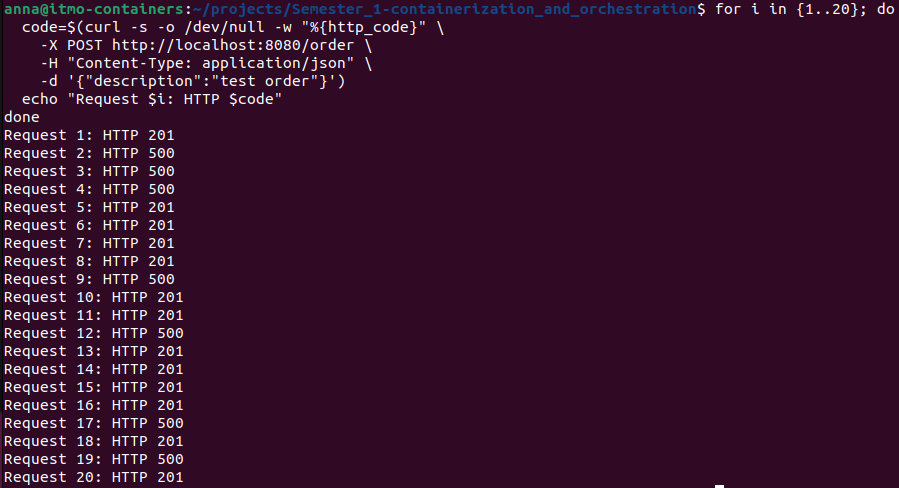

</details>

Дополнительно проверим существующие endpoints:

```bash
curl -i http://localhost:8080/health
curl -s http://localhost:8080/orders | python3 -m json.tool
```

`GET /health` возвращает HTTP 200 и `ok`.

`GET /orders` возвращает список из 13 заказов, соответствующих успешным POST-запросам.

Таким образом, случайные ошибки генерируются до записи в PostgreSQL, а успешные запросы корректно сохраняют данные.

### Сборка и проверка Docker-образа

Для приложения используется многоэтапный [Dockerfile](api/Dockerfile):

- на первом этапе Maven собирает JAR-файл приложения;
- на втором этапе приложение переносится в образ с Java 21 JRE;
- приложение запускается от непривилегированного пользователя.

Соберем Docker-образ:

```bash
cd lab6/api
docker build -t shop-api:lab6 .
```

Результат:

```text
Successfully built 1e65805c1199
Successfully tagged shop-api:lab6
```

Проверим работу приложения внутри контейнера с включенным `FAIL=true`:

```bash
docker run -d --rm \
  --name lab6-api-test \
  -p 127.0.0.1:8081:8080 \
  -e API_VERSION=v2 \
  -e FAIL=true \
  shop-api:lab6
```

Проверим версию:

```bash
curl -i http://localhost:8081/version
```

Результат:

```text
HTTP/1.1 200
v2
```

Отправим запрос на создание заказа:

```bash
curl -i -X POST http://localhost:8081/order \
  -H "Content-Type: application/json" \
  -d '{"description":"docker test"}'
```

Результат:

```text
HTTP/1.1 500
```

<details>
<summary>Результат проверки Docker-образа</summary>

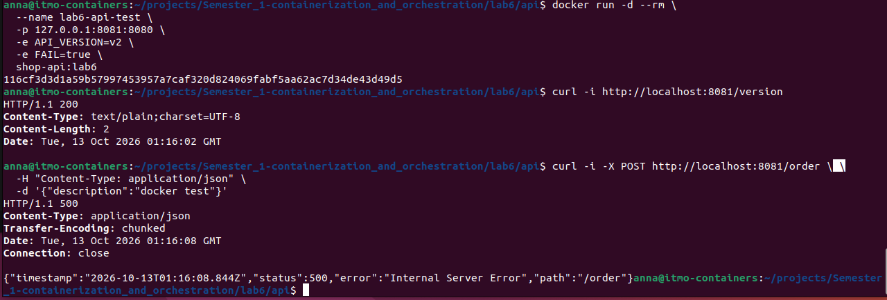

</details>

Таким образом, приложение корректно работает внутри Docker-контейнера, а его версия и режим генерации ошибок управляются переменными окружения.


## Часть 1 - Выбор service mesh

Для лабораторной работы выбран service mesh `Linkerd`.

В качестве вариантов рассматривались `Linkerd` и `Istio ambient`. Оба решения поддерживают шифрование трафика через mTLS, управление HTTP-маршрутизацией и механизмы повышения надежности приложений.

Для данной работы выбран `Linkerd` по следующим причинам:

- Linkerd использует легковесные proxy, написанные на Rust, что позволяет уменьшить нагрузку на ресурсы небольшого Kubernetes-кластера;
- автоматически обеспечивает mTLS между сервисами, подключенными к mesh, с проверкой идентичности через сертификаты;
- поддерживает HTTP retries и timeouts для обработки временных ошибок без изменения кода приложения;
- позволяет распределять трафик между версиями приложения через `HTTPRoute` с указанием весов `backendRefs`;
- предоставляет Prometheus-метрики запросов, ошибок, задержек и работы proxy;
- поддерживает подключение отдельных приложений к mesh без необходимости изменять все сервисы кластера.

`Istio ambient` позволяет обходиться без sidecar-proxy в Pod-ах приложений. Однако для необходимых в этой лабораторной работе функций уровня HTTP, включая retries и traffic split, требуется дополнительный компонент `waypoint proxy`.

Для небольшого кластера и ограниченных ресурсов виртуальной машины выбран Linkerd как более простой вариант с необходимой функциональностью.

Для реализации лабораторной работы планируется использовать:

- `Linkerd` - service mesh;
- `mTLS` - шифрование и аутентификация соединений;
- `HTTPRoute` - распределение трафика между API v1 и v2;
- `retries` - повторные запросы при временных ошибках;
- `Prometheus` и `Grafana` из Лабы 2 - сбор и отображение метрик.

Начальное распределение трафика будет составлять 90% для `v1` и 10% для `v2`. В дальнейшем веса будут автоматически изменяться скриптом-рейт на основании показателей ошибок и задержек.

Поскольку Linkerd 2.20 официально поддерживает Kubernetes до версии 1.35, для работы планируется использовать отдельный однодовый kind-кластер с совместимой версией Kubernetes.

В Части 3 выполнены установка Linkerd, подключение API к mesh через Helm-chart и проверка mTLS. Для включения proxy-injection будут использоваться аннотации Pod-ов, задаваемые через `values.yaml`.

## Часть 2 - Замерь baseline
Настроим дашборд для нагрузочного тестирования со следующими метриками:
- `POST /order p95 latency`
- `CPU usage` - использования CPU в разрезе каждого пода `api`
- `Memory working set` - использование памяти в разрезе каждого пода `api`

В пункте 8 в последние две метрики будет добавлена величина занимаемых ресурсов со стороны прокси.

Запустим нагрузку 100rps и снимем графики измеряемых величин за время тестирования:
```bash
pona@pona-RedmiBook-14:~/Documents/Semester_1-containerization_and_orchestration$ hey \
  -z 15m \
  -c 50 \
  -q 2 \
  -m POST \
  -T application/json \
  -d '{"description":"lab6-load-test"}' \
  "http://${API_IP}:30082/order"
```
<details>
<summary>Результат</summary>

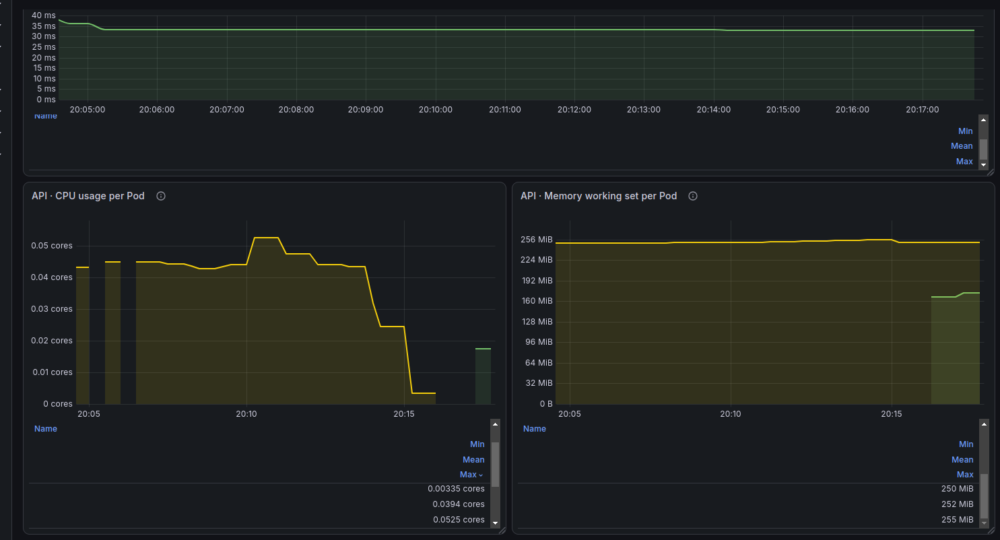
</details>

## Часть 3 - Подключение API к service mesh и проверка mTLS

Для проверки шифрования трафика между Pod-ами API был развернут Linkerd в отдельном Kubernetes-кластере `kind-lab6`.

Приложение разворачивается через Helm-chart [install](install), скопированный из Лабы 3 и адаптированный для использования с Linkerd.

Для работы приложения также установлен оператор CloudNativePG, который управляет PostgreSQL, и подготовлен Docker-образ миграций Flyway.

### Подключение API к Linkerd

В [values.yaml](install/values.yaml) добавлена настройка:

```yaml
api:
  mesh:
    enabled: true
```

В [api-deployment.yaml](install/templates/api-deployment.yaml) добавлена аннотация для автоматического подключения Linkerd proxy:

```yaml
{{- if .Values.api.mesh.enabled }}
annotations:
  linkerd.io/inject: "enabled"
{{- end }}
```

Таким образом, подключение API к service mesh управляется через `values.yaml` без изменения исходного кода Java-приложения.

Проверим корректность Helm-chart:

```bash
helm lint lab6/install
```

Результат:

```text
1 chart(s) linted, 0 chart(s) failed
```

Для развёртывания приложения использовались Docker-образы `shop-api:lab6` и `lab3-migration:1.0`, предварительно загруженные в kind-кластер.

Установим приложение:

```bash
helm upgrade --install shop lab6/install \
  --namespace lab6 \
  --create-namespace \
  --kube-context kind-lab6 \
  --wait \
  --wait-for-jobs \
  --timeout 10m
```

Установка завершилась успешно:

```text
NAME: shop
NAMESPACE: lab6
STATUS: deployed
REVISION: 2
DESCRIPTION: Upgrade complete
```

Проверим состояние Pod-ов:

```bash
kubectl --context kind-lab6 get pods -n lab6 -o wide
```

В результате получены две работающие реплики API со статусом `2/2 Running`, один работающий Pod PostgreSQL и успешно завершенная Job миграции (`Completed`).

Дополнительно проверим наличие Linkerd proxy в обеих репликах:

```bash
kubectl --context kind-lab6 get pods -n lab6 \
  -l app.kubernetes.io/name=shop-api \
  -o jsonpath='{range .items[*]}{.metadata.name}{"\nОбычные: "}{.spec.containers[*].name}{"\nInit: "}{range .spec.initContainers[*]}{.name}{" (restartPolicy="}{.restartPolicy}{") "}{end}{"\n\n"}{end}'
```

В каждом API Pod-е обнаружены контейнеры `api`, `linkerd-init`, `linkerd-proxy` и `wait-for-schema-migrations`.

При этом `linkerd-proxy` работает как Native Sidecar с параметром `restartPolicy=Always`, то есть продолжает работать на протяжении всего жизненного цикла Pod-а.

### Проверка состояния Linkerd

Выполним проверку control plane и proxy:

```bash
linkerd --context kind-lab6 check --proxy -n lab6
```

Проверка завершилась успешно:

```text
Status check results are √
```


Проверка подтвердила корректность конфигурации сертификатов Linkerd, действительность доверенных сертификатов (trust anchors) и соответствие сертификатов data plane proxy центру сертификации.

<details>
<summary>Проверка сертификатов Linkerd</summary>

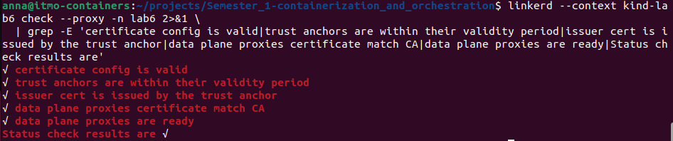

</details>

### Проверка взаимодействия между API Pod-ами

Для проверки взаимодействия между репликами отправим HTTP-запрос из первого API Pod-а во второй.

Во время проверки первый Pod имел IP-адрес `10.244.0.15`, второй - `10.244.0.14`.

```bash
kubectl --context kind-lab6 exec -n lab6 \
  shop-api-f898cf7cf-kbc9k -c api -- \
  curl -sS -i --max-time 10 http://10.244.0.14:8080/version
```

Получен ответ:

```text
HTTP/1.1 200 OK

v1
```

Запрос отправлялся по протоколу HTTP, поскольку шифрование соединения между Pod-ами выполняется автоматически средствами Linkerd proxy.

<details>
<summary>Результат HTTP-запроса между API Pod-ами</summary>

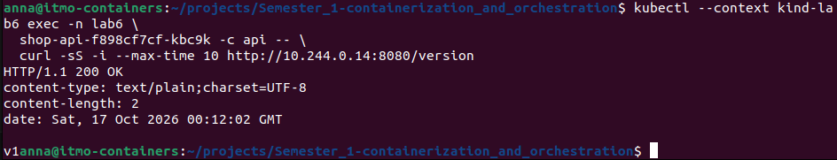

</details>

### Проверка mTLS

Для подтверждения шифрования и взаимной аутентификации получим метрики Linkerd на обеих сторонах соединения.

Сначала проверим входящий трафик на принимающем Pod-е:

```bash
linkerd --context kind-lab6 diagnostics proxy-metrics \
  -n lab6 po/shop-api-f898cf7cf-wlq6t \
  | grep '^request_total{' \
  | grep 'tls="true"' \
  | head -5
```

В метрике `request_total` получены параметры:

- `direction="inbound"` - входящий запрос;
- `tls="true"` - соединение защищено TLS;
- `client_id="default.lab6.serviceaccount.identity.linkerd.cluster.local"` - подтвержденная identity отправителя.

Это показывает, что принимающий proxy обработал зашифрованный запрос и установил идентичность отправителя.

<details>
<summary>Проверка входящего mTLS-трафика</summary>

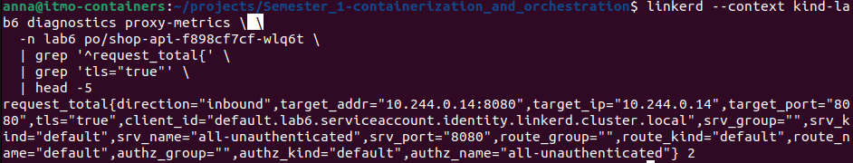

</details>

Аналогично проверим исходящий трафик на отправляющем Pod-е:

```bash
linkerd --context kind-lab6 diagnostics proxy-metrics \
  -n lab6 po/shop-api-f898cf7cf-kbc9k \
  | grep '^request_total{direction="outbound"' \
  | grep 'tls="true"' \
  | head -5
```

В метрике `request_total` обнаружены:

- `direction="outbound"` - исходящий запрос;
- `tls="true"` - соединение защищено TLS;
- `server_id="default.lab6.serviceaccount.identity.linkerd.cluster.local"` - подтвержденная identity получателя;
- `dst_pod="shop-api-f898cf7cf-wlq6t"` - Pod, которому адресован запрос.

Таким образом, Linkerd подтвердил шифрование трафика и identity принимающей стороны.

<details>
<summary>Проверка исходящего mTLS-трафика</summary>

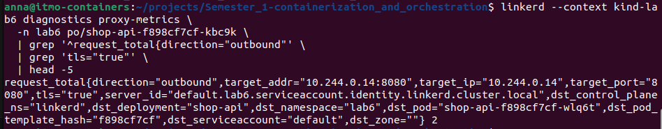

</details>

В результате проверено, что две реплики API успешно взаимодействуют между собой, а Linkerd обеспечивает шифрование соединения через mTLS и взаимную аутентификацию с помощью сертификатов identity.

Обе реплики используют ServiceAccount `default`, поэтому имеют одинаковую identity. При этом текущая политика Linkerd допускает также неаутентифицированный трафик. Проверка подтверждает использование mTLS для выполненного запроса, но не принудительное шифрование всех возможных соединений.

## Часть 4 - Повышение надёжности при FLAKY=true

Для проверки устойчивости приложения к временным ошибкам использовался механизм повторных HTTP-запросов (retries) в Linkerd.

В части 0 для версии `v1` была реализована генерация HTTP 500 с вероятностью 30% при обращении к `POST /order`. Теперь необходимо сравнить работу приложения с отключёнными и включёнными retries.

### Настройка FLAKY в Helm

В [values.yaml](install/values.yaml) добавлены параметры:

```yaml
api:
  flaky: false
  retry:
    enabled: false
    limit: 2
```

В [api-deployment.yaml](install/templates/api-deployment.yaml) добавлена переменная окружения:

```yaml
- name: FLAKY
  value: "{{ .Values.api.flaky }}"
```

Таким образом, режим генерации ошибок можно включать через Helm без изменения Java-кода и пересборки Docker-образа.

Для первого эксперимента включим `FLAKY=true`, оставив retries выключенными:

```bash
helm upgrade --install shop lab6/install \
  --namespace lab6 \
  --kube-context kind-lab6 \
  --set api.flaky=true \
  --wait \
  --wait-for-jobs \
  --timeout 10m
```

Установка завершилась успешно. Обе реплики API находились в состоянии `2/2 Running`.

Проверим значение переменной в Deployment:

```bash
kubectl --context kind-lab6 -n lab6 \
  get deployment shop-api -o yaml | grep -A 1 'name: FLAKY'
```

Результат:

```text
- name: FLAKY
  value: "true"
```

### Проверка без retries

Для измерения исходной доли ошибок отправим 50 запросов `POST /order` через Kubernetes Service `shop-api`.

Запросы выполняются из одного API Pod-а с использованием `kubectl exec` и `curl`.

```bash
kubectl --context kind-lab6 exec -n lab6 \
  deployment/shop-api -c api -- bash -c '
ok=0
err=0
other=0

for i in {1..50}; do
  code=$(curl -sS --max-time 10 -o /dev/null -w "%{http_code}" \
    -X POST http://shop-api:8080/order \
    -H "Content-Type: application/json" \
    -d "{\"description\":\"lab6 flaky baseline\"}")

  echo "Request $i: HTTP $code"

  case "$code" in
    201) ((ok++)) ;;
    500) ((err++)) ;;
    *) ((other++)) ;;
  esac
done

echo "--------------------"
echo "Successful: $ok"
echo "Errors 500: $err"
echo "Other: $other"
echo "Error rate: $((err * 100 / 50))%"
'
```

Получены следующие результаты:

| Результат | Количество | Доля |
|---|---:|---:|
| HTTP 201 | 34 | 68% |
| HTTP 500 | 16 | 32% |
| Всего | 50 | 100% |

Фактическая доля ошибок составила 32%, что близко к заданной вероятности 30%.

<details>
<summary>Результат проверки без retries</summary>

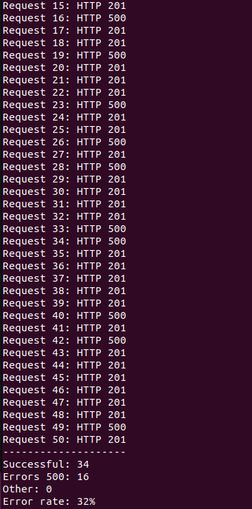

</details>

### Настройка retries в Linkerd

Для обработки временных HTTP 500 в [api-service.yaml](install/templates/api-service.yaml) добавлены аннотации Linkerd:

```yaml
{{- if .Values.api.retry.enabled }}
retry.linkerd.io/http: "500"
retry.linkerd.io/limit: "{{ .Values.api.retry.limit }}"
{{- end }}
```

Аннотация `retry.linkerd.io/http` определяет HTTP-коды, при которых выполняется повторная попытка. Параметр `retry.linkerd.io/limit` ограничивает количество дополнительных попыток.

В нашем случае Linkerd может выполнить до двух повторов после неудачного запроса.

Включим retries, сохранив `FLAKY=true`:

```bash
helm upgrade --install shop lab6/install \
  --namespace lab6 \
  --kube-context kind-lab6 \
  --set api.flaky=true \
  --set api.retry.enabled=true \
  --wait \
  --wait-for-jobs \
  --timeout 10m
```

Результат:

```text
STATUS: deployed
REVISION: 4
DESCRIPTION: Upgrade complete
```

Проверим аннотации Service:

```bash
kubectl --context kind-lab6 -n lab6 \
  get service shop-api -o yaml | grep -A 2 'retry.linkerd.io/http'
```

Получены значения:

```yaml
retry.linkerd.io/http: "500"
retry.linkerd.io/limit: "2"
```

### Проверка с retries

Повторим эксперимент из 50 запросов с теми же параметрами, используя описание заказа `lab6 flaky after retries`.

Получены следующие результаты:

| Результат | Количество | Доля |
|---|---:|---:|
| HTTP 201 | 48 | 96% |
| HTTP 500 | 2 | 4% |
| Всего | 50 | 100% |

После включения retries доля ошибок снизилась с 32% до 4%.

<details>
<summary>Результат проверки с retries</summary>

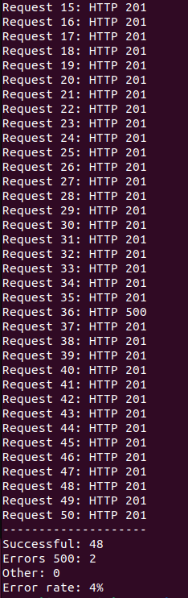

</details>

### Проверка повторных попыток по метрикам Linkerd

Для подтверждения работы retries получим метрики исходящего Linkerd proxy:

```bash
linkerd --context kind-lab6 diagnostics proxy-metrics \
  -n lab6 po/shop-api-84577c69dc-khmdp \
  | grep -E '^outbound_http_route_(request_statuses_total|backend_requests_total|backend_response_statuses_total)\{' \
  | grep 'shop-api'
```

В метриках обнаружены следующие значения:

| Метрика | Значение |
|---|---:|
| `outbound_http_route_backend_requests_total` | 75 |
| Итоговые ответы HTTP 201 | 48 |
| Итоговые ответы HTTP 500 | 2 |
| Ответы HTTP 500 от backend | 27 |

Таким образом, на 50 клиентских запросов пришлось 75 обращений к backend.

Разница составляет 25 дополнительных попыток, что подтверждает работу механизма retries.

Из 27 ответов HTTP 500 от backend только 2 дошли до клиента в качестве окончательной ошибки. Остальные неудачные попытки были обработаны механизмом повторных запросов.

<details>
<summary>Метрики Linkerd с подтверждением retries</summary>

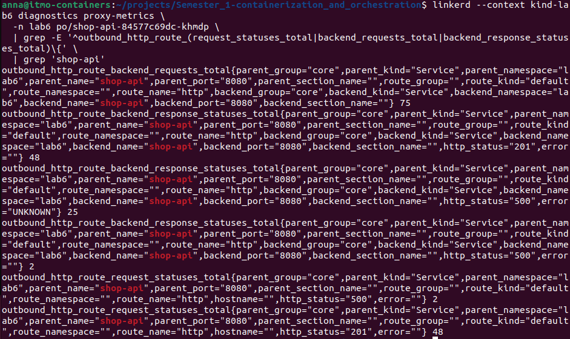

</details>

### Проверка сохранённых заказов в PostgreSQL

Поскольку endpoint `POST /order` создаёт записи в базе данных, дополнительно проверим количество сохранённых заказов.

Выполним SQL-запрос внутри Pod-а PostgreSQL:

```bash
kubectl --context kind-lab6 exec -n lab6 \
  shop-postgres-1 -c postgres -- \
  psql -U postgres -d shop -c \
  "SELECT description, COUNT(*) AS saved_orders
   FROM orders
   WHERE description IN ('lab6 flaky baseline', 'lab6 flaky after retries')
   GROUP BY description
   ORDER BY description;"
```

Получен результат:

```text
       description        | saved_orders
--------------------------+-------------
 lab6 flaky after retries |          48
 lab6 flaky baseline      |          34
(2 rows)
```

Количество сохранённых заказов совпадает с количеством успешных клиентских запросов в обоих экспериментах.

Это объясняется тем, что случайная ошибка `FLAKY=true` генерируется до записи заказа в PostgreSQL. В рамках выполненных тестов дублирование заказов не обнаружено.

<details>
<summary>Проверка заказов в PostgreSQL</summary>

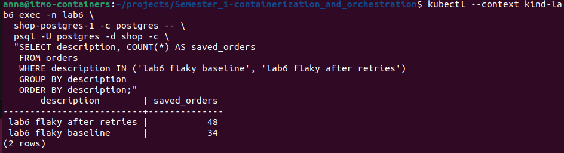

</details>

### Сравнение результатов

| Показатель | Без retries | С retries |
|---|---:|---:|
| Всего запросов | 50 | 50 |
| Успешных запросов | 34 | 48 |
| Ошибок HTTP 500 | 16 | 2 |
| Доля ошибок | 32% | 4% |
| Сохранённых заказов | 34 | 48 |


Для наглядного сравнения с помощью Python и Matplotlib построен график доли ошибок HTTP 500 на стороне backend и клиента. Код построения графика находится в plot_retries.py.

Без retries доля ошибок составляла 32%. После включения retries backend возвращал HTTP 500 в 36% попыток, однако клиент получил только 4% ошибок.

<details>
<summary>График сравнения ошибок до и после retries</summary>

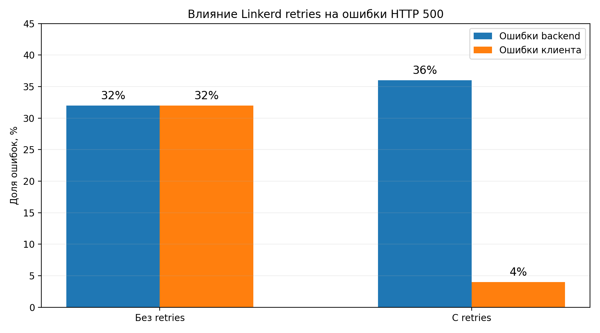

</details>

Использование retries в Linkerd позволило снизить долю ошибок с 32% до 4%, то есть в 8 раз.

Результаты подтверждают, что повторные запросы позволяют повысить надёжность приложения при временных ошибках. При этом для реального использования retries с неидемпотентными POST-запросами необходима дополнительная защита от дублирования операций.
