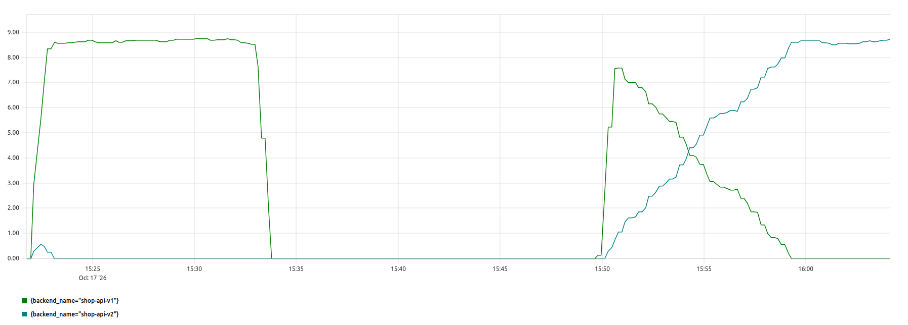
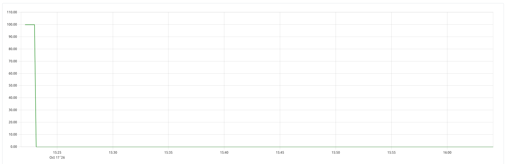
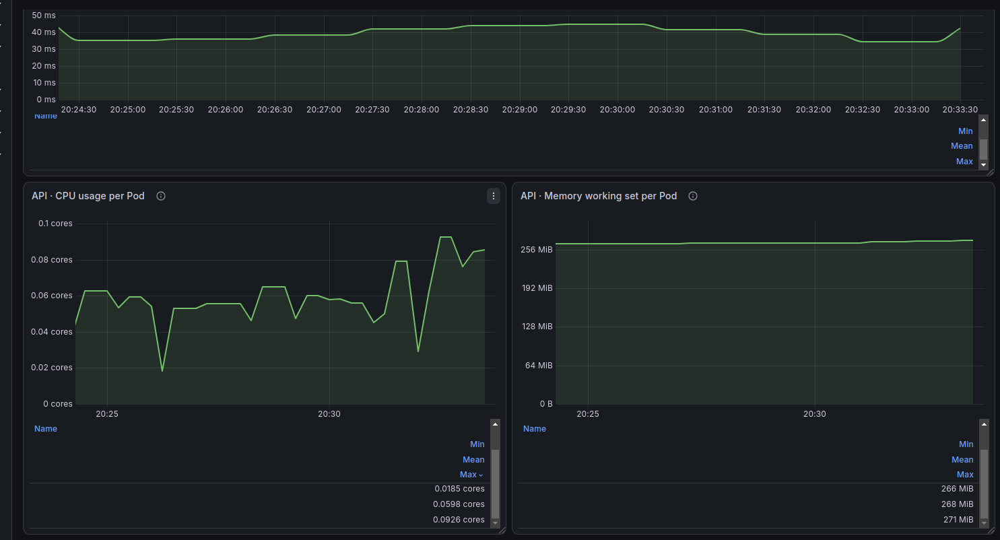

# Лабораторная работа №6 - Автопилот релиза: катит хорошее, откатывает плохое

## Часть 0 - Сервисы

Для лабораторной работы было расширено Java-приложение `api` из Лабы 3. Исходный код реализован в [api](api), чтобы сохранить работоспособность предыдущих лабораторных.

Основная задача - подготовить две версии `api` для последующего канареечного развертывания, а также реализовать управляемую генерацию ошибок для проверки надежности service mesh и автоматического отката релиза.

В приложении сохранены существующие endpoints:

- `GET /health` - проверка состояния приложения;
- `POST /order` - создание заказа в PostgreSQL;
- `GET /orders` - получение списка заказов.

Дополнительно реализованы:

- `GET /version` - возвращает текущую версию `v1` или `v2`;
- `FAIL=true` - заставляет `v2` возвращать HTTP 500 при создании заказа;
- `FLAKY=true` - заставляет `v1` случайным образом возвращать HTTP 500 с вероятностью 30%.

### Реализация версий API

Для определения версии приложения создан контроллер [VersionController.java](api/src/main/java/org/panini/controllers/VersionController.java).

Версия задается через переменную окружения `API_VERSION`.

В [application.yaml](api/src/main/resources/application.yaml) добавлены настройки:

```yaml
api:
  version: ${API_VERSION:v1}
  fail: ${FAIL:false}
  flaky: ${FLAKY:false}
```

Если переменные окружения не заданы, приложение запускается как `v1`, а оба переключателя ошибок выключены.

Таким образом, для запуска разных версий не требуется изменять исходный код приложения.

Соберем приложение:

```bash
cd lab6/api
mvn clean package -DskipTests
```

Сборка завершилась успешно:

```text
BUILD SUCCESS
```

Запустим первую версию:

```bash
API_VERSION=v1 java -jar target/lab3-api-1.0.0.jar
```

Проверим endpoint:

```bash
curl -i http://localhost:8080/version
```

Результат:

```text
HTTP/1.1 200
v1
```

После остановки приложения запустим вторую версию:

```bash
API_VERSION=v2 java -jar target/lab3-api-1.0.0.jar
```

Результат запроса `GET /version`:

```text
HTTP/1.1 200
v2
```

Таким образом, обе версии приложения успешно запускаются и возвращают соответствующее значение через `GET /version`.

### Реализация FAIL=true

В [OrderController.java](api/src/main/java/org/panini/controllers/OrderController.java) добавлена проверка версии приложения и переключателя `FAIL`.

Если приложение запущено с `API_VERSION=v2` и `FAIL=true`, метод `POST /order` принудительно возвращает HTTP 500.

```java
if ("v2".equals(version) && fail) {
    throw new ResponseStatusException(
            HttpStatus.INTERNAL_SERVER_ERROR,
            "v2 forced failure"
    );
}
```

Ошибка возникает до обращения к PostgreSQL, поэтому такой запрос не создает заказ в базе данных.

Запустим приложение:

```bash
API_VERSION=v2 FAIL=true java -jar target/lab3-api-1.0.0.jar
```

Отправим запрос:

```bash
curl -i -X POST http://localhost:8080/order \
  -H "Content-Type: application/json" \
  -d '{"description":"test order"}'
```

Получен ответ:

```text
HTTP/1.1 500
```

Таким образом, переключатель `FAIL=true` работает корректно и позволяет имитировать неудачный релиз `v2`.

### Реализация FLAKY=true

Для версии `v1` реализована случайная генерация ошибок с помощью `ThreadLocalRandom`.

```java
if ("v1".equals(version) && flaky
        && ThreadLocalRandom.current().nextDouble() < 0.3) {
    throw new ResponseStatusException(
            HttpStatus.INTERNAL_SERVER_ERROR,
            "v1 random failure"
    );
}
```

При каждом запросе `POST /order` генерируется случайное число от 0 до 1. Если полученное значение меньше `0.3`, возвращается HTTP 500. В остальных случаях выполняется обычное создание заказа.

Вероятность ошибки составляет 30%.

Для проверки использовался отдельный контейнер PostgreSQL 16 Alpine, запущенный без Kubernetes:

```bash
docker run -d \
  --name lab6-postgres \
  --rm \
  -e POSTGRES_DB=shop \
  -e POSTGRES_USER=shop \
  -e POSTGRES_PASSWORD=shop \
  -p 127.0.0.1:5432:5432 \
  postgres:16-alpine
```

Таблица `orders` была создана с использованием существующей SQL-миграции из Лабы 4:

```bash
docker exec -i lab6-postgres \
  psql -v ON_ERROR_STOP=1 -U shop -d shop \
  < lab4/migrations/sql/V1__create_orders.sql
```

После подготовки PostgreSQL запустим приложение:

```bash
API_VERSION=v1 FLAKY=true java -jar target/lab3-api-1.0.0.jar
```

Отправим 20 запросов `POST /order`:

```bash
for i in {1..20}; do
  code=$(curl -s -o /dev/null -w "%{http_code}" \
    -X POST http://localhost:8080/order \
    -H "Content-Type: application/json" \
    -d '{"description":"test order"}')
  echo "Request $i: HTTP $code"
done
```

Получены следующие результаты:

| Результат | Количество | Доля |
|---|---:|---:|
| HTTP 201 | 13 | 65% |
| HTTP 500 | 7 | 35% |
| Всего | 20 | 100% |

Из 20 запросов 7 завершились ошибкой HTTP 500, остальные 13 успешно создали заказы.

Фактическая доля ошибок составила 35%, что согласуется с заданной вероятностью 30% с учетом случайного характера генерации и небольшого количества запросов.

<details>
<summary>Результат проверки FLAKY=true</summary>


</details>

Дополнительно проверим существующие endpoints:

```bash
curl -i http://localhost:8080/health
curl -s http://localhost:8080/orders | python3 -m json.tool
```

`GET /health` возвращает HTTP 200 и `ok`.

`GET /orders` возвращает список из 13 заказов, соответствующих успешным POST-запросам.

Таким образом, случайные ошибки генерируются до записи в PostgreSQL, а успешные запросы корректно сохраняют данные.

### Сборка и проверка Docker-образа

Для приложения используется многоэтапный [Dockerfile](api/Dockerfile):

- на первом этапе Maven собирает JAR-файл приложения;
- на втором этапе приложение переносится в образ с Java 21 JRE;
- приложение запускается от непривилегированного пользователя.

Соберем Docker-образ:

```bash
cd lab6/api
docker build -t shop-api:lab6 .
```

Результат:

```text
Successfully built 1e65805c1199
Successfully tagged shop-api:lab6
```

Проверим работу приложения внутри контейнера с включенным `FAIL=true`:

```bash
docker run -d --rm \
  --name lab6-api-test \
  -p 127.0.0.1:8081:8080 \
  -e API_VERSION=v2 \
  -e FAIL=true \
  shop-api:lab6
```

Проверим версию:

```bash
curl -i http://localhost:8081/version
```

Результат:

```text
HTTP/1.1 200
v2
```

Отправим запрос на создание заказа:

```bash
curl -i -X POST http://localhost:8081/order \
  -H "Content-Type: application/json" \
  -d '{"description":"docker test"}'
```

Результат:

```text
HTTP/1.1 500
```

<details>
<summary>Результат проверки Docker-образа</summary>


</details>

Таким образом, приложение корректно работает внутри Docker-контейнера, а его версия и режим генерации ошибок управляются переменными окружения.


## Часть 1 - Выбор service mesh

Для лабораторной работы выбран service mesh `Linkerd`.

В качестве вариантов рассматривались `Linkerd` и `Istio ambient`. Оба решения поддерживают шифрование трафика через mTLS, управление HTTP-маршрутизацией и механизмы повышения надежности приложений.

Для данной работы выбран `Linkerd` по следующим причинам:

- Linkerd использует легковесные proxy, написанные на Rust, что позволяет уменьшить нагрузку на ресурсы небольшого Kubernetes-кластера;
- автоматически обеспечивает mTLS между сервисами, подключенными к mesh, с проверкой идентичности через сертификаты;
- поддерживает HTTP retries и timeouts для обработки временных ошибок без изменения кода приложения;
- позволяет распределять трафик между версиями приложения через `HTTPRoute` с указанием весов `backendRefs`;
- предоставляет Prometheus-метрики запросов, ошибок, задержек и работы proxy;
- поддерживает подключение отдельных приложений к mesh без необходимости изменять все сервисы кластера.

`Istio ambient` позволяет обходиться без sidecar-proxy в Pod-ах приложений. Однако для необходимых в этой лабораторной работе функций уровня HTTP, включая retries и traffic split, требуется дополнительный компонент `waypoint proxy`.

Для небольшого кластера и ограниченных ресурсов виртуальной машины выбран Linkerd как более простой вариант с необходимой функциональностью.

Для реализации лабораторной работы планируется использовать:

- `Linkerd` - service mesh;
- `mTLS` - шифрование и аутентификация соединений;
- `HTTPRoute` - распределение трафика между API v1 и v2;
- `retries` - повторные запросы при временных ошибках;
- `Prometheus` и `Grafana` из Лабы 2 - сбор и отображение метрик.

Начальное распределение трафика будет составлять 90% для `v1` и 10% для `v2`. В дальнейшем веса будут автоматически изменяться скриптом-рейт на основании показателей ошибок и задержек.

Поскольку Linkerd 2.20 официально поддерживает Kubernetes до версии 1.35, для работы планируется использовать отдельный однодовый kind-кластер с совместимой версией Kubernetes.

В Части 3 выполнены установка Linkerd, подключение API к mesh через Helm-chart и проверка mTLS. Для включения proxy-injection будут использоваться аннотации Pod-ов, задаваемые через `values.yaml`.

## Часть 2 - Замерь baseline
Настроим дашборд для нагрузочного тестирования со следующими метриками:
- `POST /order p95 latency`
- `CPU usage` - использования CPU в разрезе каждого пода `api`
- `Memory working set` - использование памяти в разрезе каждого пода `api`

В пункте 8 в последние две метрики будет добавлена величина занимаемых ресурсов со стороны прокси.

Запустим нагрузку 100rps и снимем графики измеряемых величин за время тестирования:
```bash
pona@pona-RedmiBook-14:~/Documents/Semester_1-containerization_and_orchestration$ hey \
  -z 15m \
  -c 50 \
  -q 2 \
  -m POST \
  -T application/json \
  -d '{"description":"lab6-load-test"}' \
  "http://${API_IP:?API_IP не задан}:30082/order"

Summary:
  Total:	900.0395 secs
  Slowest:	6.5431 secs
  Fastest:	0.0038 secs
  Average:	0.0406 secs
  Requests/sec:	99.2334
  
  Total data:	11105093 bytes
  Size/request:	124 bytes

Response time histogram:
  0.004 [1]	|
  0.658 [88828]	|■■■■■■■■■■■■■■■■■■■■■■■■■■■■■■■■■■■■■■■■
  1.312 [421]	|
  1.966 [14]	|
  2.620 [0]	|
  3.273 [0]	|
  3.927 [0]	|
  4.581 [21]	|
  5.235 [16]	|
  5.889 [8]	|
  6.543 [5]	|


Latency distribution:
  10% in 0.0088 secs
  25% in 0.0146 secs
  50% in 0.0219 secs
  75% in 0.0316 secs
  90% in 0.0385 secs
  95% in 0.0634 secs
  99% in 0.5009 secs

Details (average, fastest, slowest):
  DNS+dialup:	0.0000 secs, 0.0038 secs, 6.5431 secs
  DNS-lookup:	0.0000 secs, 0.0000 secs, 0.0000 secs
  req write:	0.0000 secs, 0.0000 secs, 0.0073 secs
  resp wait:	0.0405 secs, 0.0038 secs, 6.5421 secs
  resp read:	0.0000 secs, 0.0000 secs, 0.0039 secs

Status code distribution:
  [201]	89314 responses
```

Результаты нагрузочного тестирования:
- 99% запросов отработали менее чем за 0.5009 секунды
- среднее количество памяти, потребляемое за время эксперимента после прогрева приложения - 252 MiB
- средняя нагрузка на CPU после прогрева приложения - 0.0174 cores

<details>
<summary>Результат</summary>


</details>

## Часть 3 - Подключение API к service mesh и проверка mTLS

Для проверки шифрования трафика между Pod-ами API был развернут Linkerd в отдельном Kubernetes-кластере `kind-lab6`.

Приложение разворачивается через Helm-chart [install](install), скопированный из Лабы 3 и адаптированный для использования с Linkerd.

Для работы приложения также установлен оператор CloudNativePG, который управляет PostgreSQL, и подготовлен Docker-образ миграций Flyway.

### Подключение API к Linkerd

В [values.yaml](install/values.yaml) добавлена настройка:

```yaml
api:
  mesh:
    enabled: true
```

В [api-deployment.yaml](install/templates/api-deployment.yaml) добавлена аннотация для автоматического подключения Linkerd proxy:

```yaml
{{- if .Values.api.mesh.enabled }}
annotations:
  linkerd.io/inject: "enabled"
{{- end }}
```

Таким образом, подключение API к service mesh управляется через `values.yaml` без изменения исходного кода Java-приложения.

Проверим корректность Helm-chart:

```bash
helm lint lab6/install
```

Результат:

```text
1 chart(s) linted, 0 chart(s) failed
```

Для развёртывания приложения использовались Docker-образы `shop-api:lab6` и `lab3-migration:1.0`, предварительно загруженные в kind-кластер.

Установим приложение:

```bash
helm upgrade --install shop lab6/install \
  --namespace lab6 \
  --create-namespace \
  --kube-context kind-lab6 \
  --wait \
  --wait-for-jobs \
  --timeout 10m
```

Установка завершилась успешно:

```text
NAME: shop
NAMESPACE: lab6
STATUS: deployed
REVISION: 2
DESCRIPTION: Upgrade complete
```

Проверим состояние Pod-ов:

```bash
kubectl --context kind-lab6 get pods -n lab6 -o wide
```

В результате получены две работающие реплики API со статусом `2/2 Running`, один работающий Pod PostgreSQL и успешно завершенная Job миграции (`Completed`).

Дополнительно проверим наличие Linkerd proxy в обеих репликах:

```bash
kubectl --context kind-lab6 get pods -n lab6 \
  -l app.kubernetes.io/name=shop-api \
  -o jsonpath='{range .items[*]}{.metadata.name}{"\nОбычные: "}{.spec.containers[*].name}{"\nInit: "}{range .spec.initContainers[*]}{.name}{" (restartPolicy="}{.restartPolicy}{") "}{end}{"\n\n"}{end}'
```

В каждом API Pod-е обнаружены контейнеры `api`, `linkerd-init`, `linkerd-proxy` и `wait-for-schema-migrations`.

При этом `linkerd-proxy` работает как Native Sidecar с параметром `restartPolicy=Always`, то есть продолжает работать на протяжении всего жизненного цикла Pod-а.

### Проверка состояния Linkerd

Выполним проверку control plane и proxy:

```bash
linkerd --context kind-lab6 check --proxy -n lab6
```

Проверка завершилась успешно:

```text
Status check results are √
```


Проверка подтвердила корректность конфигурации сертификатов Linkerd, действительность доверенных сертификатов (trust anchors) и соответствие сертификатов data plane proxy центру сертификации.

<details>
<summary>Проверка сертификатов Linkerd</summary>


</details>

### Проверка взаимодействия между API Pod-ами

Для проверки взаимодействия между репликами отправим HTTP-запрос из первого API Pod-а во второй.

Во время проверки первый Pod имел IP-адрес `10.244.0.15`, второй - `10.244.0.14`.

```bash
kubectl --context kind-lab6 exec -n lab6 \
  shop-api-f898cf7cf-kbc9k -c api -- \
  curl -sS -i --max-time 10 http://10.244.0.14:8080/version
```

Получен ответ:

```text
HTTP/1.1 200 OK

v1
```

Запрос отправлялся по протоколу HTTP, поскольку шифрование соединения между Pod-ами выполняется автоматически средствами Linkerd proxy.

<details>
<summary>Результат HTTP-запроса между API Pod-ами</summary>


</details>

### Проверка mTLS

Для подтверждения шифрования и взаимной аутентификации получим метрики Linkerd на обеих сторонах соединения.

Сначала проверим входящий трафик на принимающем Pod-е:

```bash
linkerd --context kind-lab6 diagnostics proxy-metrics \
  -n lab6 po/shop-api-f898cf7cf-wlq6t \
  | grep '^request_total{' \
  | grep 'tls="true"' \
  | head -5
```

В метрике `request_total` получены параметры:

- `direction="inbound"` - входящий запрос;
- `tls="true"` - соединение защищено TLS;
- `client_id="default.lab6.serviceaccount.identity.linkerd.cluster.local"` - подтвержденная identity отправителя.

Это показывает, что принимающий proxy обработал зашифрованный запрос и установил идентичность отправителя.

<details>
<summary>Проверка входящего mTLS-трафика</summary>


</details>

Аналогично проверим исходящий трафик на отправляющем Pod-е:

```bash
linkerd --context kind-lab6 diagnostics proxy-metrics \
  -n lab6 po/shop-api-f898cf7cf-kbc9k \
  | grep '^request_total{direction="outbound"' \
  | grep 'tls="true"' \
  | head -5
```

В метрике `request_total` обнаружены:

- `direction="outbound"` - исходящий запрос;
- `tls="true"` - соединение защищено TLS;
- `server_id="default.lab6.serviceaccount.identity.linkerd.cluster.local"` - подтвержденная identity получателя;
- `dst_pod="shop-api-f898cf7cf-wlq6t"` - Pod, которому адресован запрос.

Таким образом, Linkerd подтвердил шифрование трафика и identity принимающей стороны.

<details>
<summary>Проверка исходящего mTLS-трафика</summary>


</details>

В результате проверено, что две реплики API успешно взаимодействуют между собой, а Linkerd обеспечивает шифрование соединения через mTLS и взаимную аутентификацию с помощью сертификатов identity.

Обе реплики используют ServiceAccount `default`, поэтому имеют одинаковую identity. При этом текущая политика Linkerd допускает также неаутентифицированный трафик. Проверка подтверждает использование mTLS для выполненного запроса, но не принудительное шифрование всех возможных соединений.

## Часть 4 - Повышение надёжности при FLAKY=true

Для проверки устойчивости приложения к временным ошибкам использовался механизм повторных HTTP-запросов (retries) в Linkerd.

В части 0 для версии `v1` была реализована генерация HTTP 500 с вероятностью 30% при обращении к `POST /order`. Теперь необходимо сравнить работу приложения с отключёнными и включёнными retries.

### Настройка FLAKY в Helm

В [values.yaml](install/values.yaml) добавлены параметры:

```yaml
api:
  flaky: false
  retry:
    enabled: false
    limit: 2
```

В [api-deployment.yaml](install/templates/api-deployment.yaml) добавлена переменная окружения:

```yaml
- name: FLAKY
  value: "{{ .Values.api.flaky }}"
```

Таким образом, режим генерации ошибок можно включать через Helm без изменения Java-кода и пересборки Docker-образа.

Для первого эксперимента включим `FLAKY=true`, оставив retries выключенными:

```bash
helm upgrade --install shop lab6/install \
  --namespace lab6 \
  --kube-context kind-lab6 \
  --set api.flaky=true \
  --wait \
  --wait-for-jobs \
  --timeout 10m
```

Установка завершилась успешно. Обе реплики API находились в состоянии `2/2 Running`.

Проверим значение переменной в Deployment:

```bash
kubectl --context kind-lab6 -n lab6 \
  get deployment shop-api -o yaml | grep -A 1 'name: FLAKY'
```

Результат:

```text
- name: FLAKY
  value: "true"
```

### Проверка без retries

Для измерения исходной доли ошибок отправим 50 запросов `POST /order` через Kubernetes Service `shop-api`.

Запросы выполняются из одного API Pod-а с использованием `kubectl exec` и `curl`.

```bash
kubectl --context kind-lab6 exec -n lab6 \
  deployment/shop-api -c api -- bash -c '
ok=0
err=0
other=0

for i in {1..50}; do
  code=$(curl -sS --max-time 10 -o /dev/null -w "%{http_code}" \
    -X POST http://shop-api:8080/order \
    -H "Content-Type: application/json" \
    -d "{\"description\":\"lab6 flaky baseline\"}")

  echo "Request $i: HTTP $code"

  case "$code" in
    201) ((ok++)) ;;
    500) ((err++)) ;;
    *) ((other++)) ;;
  esac
done

echo "--------------------"
echo "Successful: $ok"
echo "Errors 500: $err"
echo "Other: $other"
echo "Error rate: $((err * 100 / 50))%"
'
```

Получены следующие результаты:

| Результат | Количество | Доля |
|---|---:|---:|
| HTTP 201 | 34 | 68% |
| HTTP 500 | 16 | 32% |
| Всего | 50 | 100% |

Фактическая доля ошибок составила 32%, что близко к заданной вероятности 30%.

<details>
<summary>Результат проверки без retries</summary>


</details>

### Настройка retries в Linkerd

Для обработки временных HTTP 500 в [api-service.yaml](install/templates/api-service.yaml) добавлены аннотации Linkerd:

```yaml
{{- if .Values.api.retry.enabled }}
retry.linkerd.io/http: "500"
retry.linkerd.io/limit: "{{ .Values.api.retry.limit }}"
{{- end }}
```

Аннотация `retry.linkerd.io/http` определяет HTTP-коды, при которых выполняется повторная попытка. Параметр `retry.linkerd.io/limit` ограничивает количество дополнительных попыток.

В нашем случае Linkerd может выполнить до двух повторов после неудачного запроса.

Включим retries, сохранив `FLAKY=true`:

```bash
helm upgrade --install shop lab6/install \
  --namespace lab6 \
  --kube-context kind-lab6 \
  --set api.flaky=true \
  --set api.retry.enabled=true \
  --wait \
  --wait-for-jobs \
  --timeout 10m
```

Результат:

```text
STATUS: deployed
REVISION: 4
DESCRIPTION: Upgrade complete
```

Проверим аннотации Service:

```bash
kubectl --context kind-lab6 -n lab6 \
  get service shop-api -o yaml | grep -A 2 'retry.linkerd.io/http'
```

Получены значения:

```yaml
retry.linkerd.io/http: "500"
retry.linkerd.io/limit: "2"
```

### Проверка с retries

Повторим эксперимент из 50 запросов с теми же параметрами, используя описание заказа `lab6 flaky after retries`.

Получены следующие результаты:

| Результат | Количество | Доля |
|---|---:|---:|
| HTTP 201 | 48 | 96% |
| HTTP 500 | 2 | 4% |
| Всего | 50 | 100% |

После включения retries доля ошибок снизилась с 32% до 4%.

<details>
<summary>Результат проверки с retries</summary>


</details>

### Проверка повторных попыток по метрикам Linkerd

Для подтверждения работы retries получим метрики исходящего Linkerd proxy:

```bash
linkerd --context kind-lab6 diagnostics proxy-metrics \
  -n lab6 po/shop-api-84577c69dc-khmdp \
  | grep -E '^outbound_http_route_(request_statuses_total|backend_requests_total|backend_response_statuses_total)\{' \
  | grep 'shop-api'
```

В метриках обнаружены следующие значения:

| Метрика | Значение |
|---|---:|
| `outbound_http_route_backend_requests_total` | 75 |
| Итоговые ответы HTTP 201 | 48 |
| Итоговые ответы HTTP 500 | 2 |
| Ответы HTTP 500 от backend | 27 |

Таким образом, на 50 клиентских запросов пришлось 75 обращений к backend.

Разница составляет 25 дополнительных попыток, что подтверждает работу механизма retries.

Из 27 ответов HTTP 500 от backend только 2 дошли до клиента в качестве окончательной ошибки. Остальные неудачные попытки были обработаны механизмом повторных запросов.

<details>
<summary>Метрики Linkerd с подтверждением retries</summary>


</details>

### Проверка сохранённых заказов в PostgreSQL

Поскольку endpoint `POST /order` создаёт записи в базе данных, дополнительно проверим количество сохранённых заказов.

Выполним SQL-запрос внутри Pod-а PostgreSQL:

```bash
kubectl --context kind-lab6 exec -n lab6 \
  shop-postgres-1 -c postgres -- \
  psql -U postgres -d shop -c \
  "SELECT description, COUNT(*) AS saved_orders
   FROM orders
   WHERE description IN ('lab6 flaky baseline', 'lab6 flaky after retries')
   GROUP BY description
   ORDER BY description;"
```

Получен результат:

```text
       description        | saved_orders
--------------------------+-------------
 lab6 flaky after retries |          48
 lab6 flaky baseline      |          34
(2 rows)
```

Количество сохранённых заказов совпадает с количеством успешных клиентских запросов в обоих экспериментах.

Это объясняется тем, что случайная ошибка `FLAKY=true` генерируется до записи заказа в PostgreSQL. В рамках выполненных тестов дублирование заказов не обнаружено.

<details>
<summary>Проверка заказов в PostgreSQL</summary>


</details>

### Сравнение результатов

| Показатель | Без retries | С retries |
|---|---:|---:|
| Всего запросов | 50 | 50 |
| Успешных запросов | 34 | 48 |
| Ошибок HTTP 500 | 16 | 2 |
| Доля ошибок | 32% | 4% |
| Сохранённых заказов | 34 | 48 |


Для наглядного сравнения с помощью Python и Matplotlib построен график доли ошибок HTTP 500 на стороне backend и клиента. Код построения графика находится в plot_retries.py.

Без retries доля ошибок составляла 32%. После включения retries backend возвращал HTTP 500 в 36% попыток, однако клиент получил только 4% ошибок.

<details>
<summary>График сравнения ошибок до и после retries</summary>


</details>

Использование retries в Linkerd позволило снизить долю ошибок с 32% до 4%, то есть в 8 раз.

Результаты подтверждают, что повторные запросы позволяют повысить надёжность приложения при временных ошибках. При этом для реального использования retries с неидемпотентными POST-запросами необходима дополнительная защита от дублирования операций.

## Часть 5 - Разверни v1/v2 и раздели трафик
Для того чтобы развернуть через чарт одновременно версии `api` v1 и v2 необходимо параметризовать `Deployment` и `Service` ресурсы. Обернем описание конфигурации `Deployment` и `Service` в range:
```yaml
{{- $root := . -}}

{{- range $version, $config := .Values.api.versions }}
## параметризованная конфигурация для v1/v2

---
{{- end }}
```
В [install/values.yaml](install/values.yaml) добавим секцию `versions`:
```yaml
versions:
  v1:
    instances: 1
    fail: false
    flaky: false
  v2:
    instances: 1
    fail: false
    flaky: false
```
Таким образом при обновлении релиза будет создано 2 пода: один - версии v1, другой - v2; версия приложения задается через переменную окружения `API_VERSION`:
```yaml
- name: API_VERSION
  value: {{ $version | quote }}
```
Также понадобится создать 3 сервиса:
- 2 сервиса с типом `ClusterIP` для перенаправления запросов на `shop-api-v1` и `shop-api-v2`
- сервис с типом `NodePort` для принятия внешних запросов

Создадим ресурс `HTTPRoute` для пропорционального разделения трафика на `shop-api` (см. реализацию в [install/templates/api-httproute.yaml](install/templates/api-httproute.yaml)).

Выключим настройку `api.retry` обновим Helm релиз и проверим статус ресурсов:
```bash
pona@pona-RedmiBook-14:~/Documents/Semester_1-containerization_and_orchestration$ kubectl --context kind-lab6 get pods -n lab6 \
  -L app.kubernetes.io/version
NAME                              READY   STATUS      RESTARTS   AGE     VERSION
shop-api-v1-68dd8c66ff-nwtt9      2/2     Running     0          5m38s   v1
shop-api-v2-78484859df-jf82l      2/2     Running     0          5m38s   v2
shop-postgres-1                   1/1     Running     0          3m43s   18
shop-schema-migration-1-0-csdnm   0/1     Completed   0          5m38s   
pona@pona-RedmiBook-14:~/Documents/Semester_1-containerization_and_orchestration$ kubectl --context kind-lab6 get pod \
  shop-api-v1-68dd8c66ff-nwtt9 \
  -n lab6 \
  -o jsonpath='{range .spec.initContainers[*]}{.name}{"\trestartPolicy="}{.restartPolicy}{"\n"}{end}'
linkerd-init	restartPolicy=
linkerd-proxy	restartPolicy=Always
wait-for-schema-migrations	restartPolicy=
pona@pona-RedmiBook-14:~/Documents/Semester_1-containerization_and_orchestration$ kubectl --context kind-lab6 get pod \
  shop-api-v2-78484859df-jf82l \
  -n lab6 \
  -o jsonpath='{range .spec.initContainers[*]}{.name}{"\trestartPolicy="}{.restartPolicy}{"\n"}{end}'
linkerd-init	restartPolicy=
linkerd-proxy	restartPolicy=Always
wait-for-schema-migrations	restartPolicy=
```
Видим что поднялись 2 пода: `shop-api-v1-68dd8c66ff-nwtt9` и `shop-api-v2-78484859df-jf82l`, в каждом поде запущено 2 контейнера: `api` и `linkerd-proxy` (сохраняется засчет `restartPolicy: Always`).

Проверим, что запросы маршрутизируются в требуемых пропорциях:
```bash
pona@pona-RedmiBook-14:~/Documents/Semester_1-containerization_and_orchestration$ POD=$(
  kubectl --context kind-lab6 get pod -n lab6 \
    -l 'app.kubernetes.io/name=shop-api,app.kubernetes.io/version=v1' \
    -o jsonpath='{.items[0].metadata.name}'
)
pona@pona-RedmiBook-14:~/Documents/Semester_1-containerization_and_orchestration$ kubectl --context kind-lab6 exec -n lab6 "$POD" -c api -- \
  sh -c '
    for i in $(seq 1 1000); do
      curl -s http://shop-api:8080/version
      echo
    done
  ' |
sort |
uniq -c
    902 v1
     98 v2
```
Таким образом, traffic split настроен корректно. Запросы на поды `shop-api` отправлялись именно изнутри пода, на котором висит `linkerd-proxy`, поскольку именно этот ресурс маршрутизирует запросы в соответствии с правилами, настроенными через HttpRoute.

## Часть 6 - Собери автопилот
Сгенерируем скрипт gate для автоматического перенаправления трафика с `shop-api-v1` на `shop-api-v2` (см. подробнее в [gate](gate)). Данный скрипт работает по следующим правилам:
1. Каждые `intervalSeconds=15` секунд при условии, что за прошедшие intervalSeconds было отправлено более `minRequests=20` запросов к v2, проверяет выполнение 2х условий:
    * доля ошибок с `shop-api-v2` не превышает допустимый порог `errorThreshold=0.05` 
    * средняя задержка запросов к `shop-api-v2` за последнюю минуту не превышает допустимый порог `averageLatencyThresholdSeconds=0.5` секунд
2. В случае выполнения обоих условий процент трафика, направленного на `shop-api-v2`, И прошло более 1 минуты увеличивается на шаг `promotionStep=10`
3. В случае, если не выполнилось хотя бы 1 условие, процент запросов к `shop-api-v2` сбрасывается в 0 и выкатка версии останавливается

Нагрузка будет подаваться из отдельного mesh-пода, чтобы трафик шел через HTTPRoute.

При реализации логики выше необходимо использовать следующие метрики Prometheus:
<details>
<summary>Количество запросов, отправленных на shop-api-v2</summary>

```bash
sum(
  increase(
    outbound_http_route_backend_response_statuses_total{
      job="lab6-linkerd-proxy",
      parent_namespace="lab6",
      parent_name="shop-api",
      backend_namespace="lab6",
      backend_name="shop-api-v2"
    }[1m]
  )
)
```
</details>

<details>
<summary>Количество ошибок 5xx с shop-api-v2</summary>

```bash
sum(
  increase(
    outbound_http_route_backend_response_statuses_total{
      job="lab6-linkerd-proxy",
      parent_namespace="lab6",
      parent_name="shop-api",
      backend_namespace="lab6",
      backend_name="shop-api-v2",
      http_status=~"5.."
    }[1m]
  )
)
```
</details>

<details>
<summary>Средняя задержка запросов к shop-api-v2 за последнюю минуту</summary>

```bash

sum(
  rate(
    outbound_http_route_backend_response_duration_seconds_sum{
      job="lab6-linkerd-proxy",
      parent_namespace="lab6",
      parent_name="shop-api",
      backend_namespace="lab6",
      backend_name="shop-api-v2"
    }[1m]
  )
)
/
clamp_min(
  sum(
    rate(
      outbound_http_route_backend_response_duration_seconds_count{
        job="lab6-linkerd-proxy",
        parent_namespace="lab6",
        parent_name="shop-api",
        backend_namespace="lab6",
        backend_name="shop-api-v2"
      }[1m]
    )
  ),
  0.001
)
```
</details>

Соберем образ `shop-gate` и загрузим его в кластер: 
<details>
<summary>Результат</summary>

```bash
pona@pona-RedmiBook-14:~/Documents/Semester_1-containerization_and_orchestration$ docker build -t shop-gate:lab6 lab6/gate
[+] Building 1.4s (9/9) FINISHED                                                                                                      docker:default
 => [internal] load build definition from Dockerfile                                                                                            0.0s
 => => transferring dockerfile: 246B                                                                                                            0.0s
 => [internal] load metadata for docker.io/library/python:3.12-alpine                                                                           0.9s
 => [internal] load .dockerignore                                                                                                               0.0s
 => => transferring context: 59B                                                                                                                0.0s
 => [1/4] FROM docker.io/library/python:3.12-alpine@sha256:1b668429b3511ab407d8e00648891631b0b1a4d7e15e3ca70f38ab5b91ad4ab4                     0.1s
 => => resolve docker.io/library/python:3.12-alpine@sha256:1b668429b3511ab407d8e00648891631b0b1a4d7e15e3ca70f38ab5b91ad4ab4                     0.0s
 => [internal] load build context                                                                                                               0.0s
 => => transferring context: 29B                                                                                                                0.0s
 => CACHED [2/4] WORKDIR /app                                                                                                                   0.0s
 => CACHED [3/4] RUN addgroup -S -g 10001 gate     && adduser -S -D -H -u 10001 -G gate gate                                                    0.0s
 => CACHED [4/4] COPY gate.py /app/gate.py                                                                                                      0.0s
 => exporting to image                                                                                                                          0.2s
 => => exporting layers                                                                                                                         0.0s
 => => exporting manifest sha256:c298fd0a1df26fdfdf11a7fbbc15775c9ac57c991b5f6177662f6731e145e897                                               0.0s
 => => exporting config sha256:e30afe4601e78aea36203a4dda5f1ec4bcd7635619a04cd5c6141f6d00bccc13                                                 0.0s
 => => exporting attestation manifest sha256:694c4c66ca6f452f24532db07d572b86aa9a8a3e5adcb387b0d52173dcc63bf7                                   0.1s
 => => exporting manifest list sha256:1ffe05a5612a90fc9831b2812600036c87c3585a4581943f549db4027ad494c5                                          0.0s
 => => naming to docker.io/library/shop-gate:lab6                                                                                               0.0s
 => => unpacking to docker.io/library/shop-gate:lab6                                                                                            0.0s
pona@pona-RedmiBook-14:~/Documents/Semester_1-containerization_and_orchestration$ kind load docker-image \
  shop-gate:lab6 \
  --name lab6
Image: "shop-gate:lab6" with ID "sha256:1ffe05a5612a90fc9831b2812600036c87c3585a4581943f549db4027ad494c5" not yet present on node "lab6-control-plane", loading...
```
</details>

## Часть 7 - Проверь оба сценария
Проверим сценарий релиза с ошибкой. Выставим в [install/values.yaml](install/values.yaml) настройку для v2, при которой запросы `POST /orders` завершаются с ошибкой 500; также включим gate:
```yaml
api:
  versions:
    v1:
      instances: 1
      fail: false
      flaky: false
    v2:
      instances: 1
      fail: true
      flaky: false

gate:
  enabled: true
```

Обновим релиз:
```bash
pona@pona-RedmiBook-14:~/Documents/Semester_1-containerization_and_orchestration$ helm upgrade shop lab6/install   --namespace lab6   --kube-context kind-lab6   --wait   --timeout 10m
Release "shop" has been upgraded. Happy Helming!
NAME: shop
LAST DEPLOYED: Sat Oct 17 18:16:02 2026
NAMESPACE: lab6
STATUS: deployed
REVISION: 3
TEST SUITE: None
pona@pona-RedmiBook-14:~/Documents/Semester_1-containerization_and_orchestration$ kubectl get pods -n lab6
NAME                              READY   STATUS      RESTARTS   AGE
shop-api-v1-68dd8c66ff-nwtt9      2/2     Running     0          5h14m
shop-api-v2-65fc48cb8b-khm79      2/2     Running     0          87s
shop-gate-554658df77-6rwrt        1/1     Running     0          8s
shop-postgres-1                   1/1     Running     0          5h12m
shop-schema-migration-1-0-csdnm   0/1     Completed   0          5h14m
```
Убедимся, что `shop-api-v2-65fc48cb8b-khm79` действительно должен возвращать ошибку при отправке запроса `POST /order`, для этого проверим переменные окружения:
```bash
pona@pona-RedmiBook-14:~/Documents/Semester_1-containerization_and_orchestration$ kubectl --context kind-lab6 get deployment \
  shop-api-v2 \
  -n lab6 \
  -o jsonpath='{range .spec.template.spec.containers[?(@.name=="api")].env[*]}{.name}={.value}{"\n"}{end}'
DB_URL=
DB_USER=
DB_PASSWORD=
API_VERSION=v2
FAIL=true
FLAKY=false
```
Откроем логи `shop-gate` и убедимся, что пока запросы не идут autoscaling трафика не происходит:
```bash
pona@pona-RedmiBook-14:~/Documents/Semester_1-containerization_and_orchestration$ kubectl --context kind-lab6 logs \
  -n lab6 \
  deployment/shop-gate \
  --follow
2026-10-17 15:16:12,289 INFO release-gate started namespace=lab6 route=shop-api-split interval=15.0s
2026-10-17 15:16:12,597 INFO release-gate action=HOLD reason=insufficient v2 traffic (0.0 < 20.0) requests=0.0 error_rate=none average_latency_seconds=0.0000 weights=90/10
2026-10-17 15:16:27,609 INFO release-gate action=HOLD reason=insufficient v2 traffic (0.0 < 20.0) requests=0.0 error_rate=none average_latency_seconds=0.0000 weights=90/10
2026-10-17 15:16:42,622 INFO release-gate action=HOLD reason=insufficient v2 traffic (0.0 < 20.0) requests=0.0 error_rate=none average_latency_seconds=0.0000 weights=90/10
```
Окружение подготовлено, можно приступать к тесту. В отдельном терминале будет отправлять запросы на `shop-api` из mesh пода и посмотрим на результат работы `shop-gate`:
```bash
pona@pona-RedmiBook-14:~/Documents/Semester_1-containerization_and_orchestration$ V1_POD=$(
  kubectl --context kind-lab6 get pod \
    -n lab6 \
    -l 'app.kubernetes.io/name=shop-api,app.kubernetes.io/version=v1' \
    -o jsonpath='{.items[0].metadata.name}'
)
pona@pona-RedmiBook-14:~/Documents/Semester_1-containerization_and_orchestration$ echo "$V1_POD"
shop-api-v1-68dd8c66ff-nwtt9
pona@pona-RedmiBook-14:~/Documents/Semester_1-containerization_and_orchestration$ kubectl --context kind-lab6 exec \
  -n lab6 \
  "$V1_POD" \
  -c api \
  -- sh -c '
    i=1
    while true; do
      code=$(curl -sS -o /dev/null -w "%{http_code}" \
        -X POST \
        -H "Content-Type: application/json" \
        -d "{\"description\":\"bad-release-$i\"}" \
        http://shop-api:8080/order)

      echo "request=$i status=$code"
      i=$((i + 1))
      sleep 0.1
    done
  '
```

<details>
<summary>Результат выполнения запросов</summary>

```bash
request=1 status=201
request=2 status=201
request=3 status=201
request=4 status=500
request=5 status=201
request=6 status=201
request=7 status=201
request=8 status=201
request=9 status=201
request=10 status=201
request=11 status=201
request=12 status=201
request=13 status=201
request=14 status=201
request=15 status=201
request=16 status=201
request=17 status=201
request=18 status=201
request=19 status=201
request=20 status=201
request=21 status=201
request=22 status=201
request=23 status=201
request=24 status=201
request=25 status=500
request=26 status=201
request=27 status=201
request=28 status=201
request=29 status=201
request=30 status=201
request=31 status=201
request=32 status=201
request=33 status=201
request=34 status=201
request=35 status=201
request=36 status=500
request=37 status=201
request=38 status=201
request=39 status=201
request=40 status=201
request=41 status=201
request=42 status=201
request=43 status=201
request=44 status=201
request=45 status=201
request=46 status=201
request=47 status=201
request=48 status=500
request=49 status=201
request=50 status=201
request=51 status=201
request=52 status=201
request=53 status=201
request=54 status=201
request=55 status=201
request=56 status=201
request=57 status=201
request=58 status=201
request=59 status=201
request=60 status=201
request=61 status=500
request=62 status=201
request=63 status=201
request=64 status=201
request=65 status=201
request=66 status=201
request=67 status=201
request=68 status=201
request=69 status=201
request=70 status=201
request=71 status=500
request=72 status=201
request=73 status=201
request=74 status=201
request=75 status=201
request=76 status=201
request=77 status=201
request=78 status=201
request=79 status=500
request=80 status=201
request=81 status=201
request=82 status=201
request=83 status=201
request=84 status=201
request=85 status=201
request=86 status=201
request=87 status=201
request=88 status=201
request=89 status=201
request=90 status=500
request=91 status=201
request=92 status=201
request=93 status=201
request=94 status=500
request=95 status=500
request=96 status=201
request=97 status=201
request=98 status=201
request=99 status=201
request=100 status=201
request=101 status=201
request=102 status=201
request=103 status=201
request=104 status=201
request=105 status=500
request=106 status=201
request=107 status=201
request=108 status=201
request=109 status=201
request=110 status=201
request=111 status=201
request=112 status=201
request=113 status=201
request=114 status=201
request=115 status=201
request=116 status=201
request=117 status=201
request=118 status=201
request=119 status=201
request=120 status=201
request=121 status=201
request=122 status=500
request=123 status=201
request=124 status=500
request=125 status=201
request=126 status=201
request=127 status=201
request=128 status=201
request=129 status=201
request=130 status=201
request=131 status=201
request=132 status=201
request=133 status=201
request=134 status=201
request=135 status=201
request=136 status=201
request=137 status=201
request=138 status=201
request=139 status=201
request=140 status=201
request=141 status=201
request=142 status=500
request=143 status=201
request=144 status=201
request=145 status=201
request=146 status=201
request=147 status=201
request=148 status=201
request=149 status=201
request=150 status=201
request=151 status=201
request=152 status=201
request=153 status=201
request=154 status=201
request=155 status=201
request=156 status=201
request=157 status=500
request=158 status=201
request=159 status=201
request=160 status=201
request=161 status=201
request=162 status=201
request=163 status=201
request=164 status=201
request=165 status=500
request=166 status=201
request=167 status=201
request=168 status=201
request=169 status=201
request=170 status=201
request=171 status=201
request=172 status=201
request=173 status=201
request=174 status=500
request=175 status=201
request=176 status=201
request=177 status=201
request=178 status=201
request=179 status=201
request=180 status=201
request=181 status=201
request=182 status=201
request=183 status=201
request=184 status=201
request=185 status=201
request=186 status=201
request=187 status=201
request=188 status=201
request=189 status=201
request=190 status=500
request=191 status=201
request=192 status=201
request=193 status=201
request=194 status=201
request=195 status=201
request=196 status=201
request=197 status=201
request=198 status=201
request=199 status=201
request=200 status=201
request=201 status=201
request=202 status=201
request=203 status=201
request=204 status=201
request=205 status=201
request=206 status=500
request=207 status=201
request=208 status=201
request=209 status=201
request=210 status=201
request=211 status=201
request=212 status=201
request=213 status=201
request=214 status=201
request=215 status=201
request=216 status=201
request=217 status=201
request=218 status=500
request=219 status=201
request=220 status=201
request=221 status=500
request=222 status=201
request=223 status=201
request=224 status=500
request=225 status=201
request=226 status=201
request=227 status=201
request=228 status=201
request=229 status=201
request=230 status=500
request=231 status=201
request=232 status=201
request=233 status=201
request=234 status=201
request=235 status=500
request=236 status=201
request=237 status=201
request=238 status=201
request=239 status=201
request=240 status=201
request=241 status=201
request=242 status=201
request=243 status=201
request=244 status=500
request=245 status=500
request=246 status=201
request=247 status=201
request=248 status=201
request=249 status=201
request=250 status=201
request=251 status=201
request=252 status=201
request=253 status=201
request=254 status=201
request=255 status=201
request=256 status=201
request=257 status=201
request=258 status=201
request=259 status=201
request=260 status=201
request=261 status=201
request=262 status=201
request=263 status=201
request=264 status=201
request=265 status=201
request=266 status=201
request=267 status=201
request=268 status=201
request=269 status=201
request=270 status=201
request=271 status=201
request=272 status=201
request=273 status=201
request=274 status=201
request=275 status=201
request=276 status=201
request=277 status=201
request=278 status=201
request=279 status=201
request=280 status=201
request=281 status=201
request=282 status=201
request=283 status=201
request=284 status=201
request=285 status=201
request=286 status=201
request=287 status=201
request=288 status=201
request=289 status=201
request=290 status=201
request=291 status=201
request=292 status=201
request=293 status=201
request=294 status=201
request=295 status=201
request=296 status=201
request=297 status=201
request=298 status=201
request=299 status=201
request=300 status=201
request=301 status=201
request=302 status=201
request=303 status=201
request=304 status=201
request=305 status=201
request=306 status=201
request=307 status=201
request=308 status=201
request=309 status=201
request=310 status=201
request=311 status=201
request=312 status=201
request=313 status=201
request=314 status=201
request=315 status=201
request=316 status=201
request=317 status=201
request=318 status=201
request=319 status=201
request=320 status=201
request=321 status=201
request=322 status=201
request=323 status=201
request=324 status=201
request=325 status=201
request=326 status=201
request=327 status=201
request=328 status=201
request=329 status=201
request=330 status=201
request=331 status=201
request=332 status=201
request=333 status=201
request=334 status=201
request=335 status=201
request=336 status=201
request=337 status=201
request=338 status=201
request=339 status=201
request=340 status=201
request=341 status=201
request=342 status=201
request=343 status=201
request=344 status=201
request=345 status=201
request=346 status=201
request=347 status=201
request=348 status=201
request=349 status=201
request=350 status=201
request=351 status=201
request=352 status=201
request=353 status=201
request=354 status=201
request=355 status=201
request=356 status=201
```
</details>

Посмотрим также на логи с `shop-gate`:
```bash
2026-10-17 15:20:27,883 INFO release-gate action=HOLD reason=insufficient v2 traffic (0.0 < 20.0) requests=0.0 error_rate=none average_latency_seconds=0.0000 weights=90/10
2026-10-17 15:20:42,896 INFO release-gate action=HOLD reason=insufficient v2 traffic (0.0 < 20.0) requests=0.0 error_rate=none average_latency_seconds=0.0000 weights=90/10
2026-10-17 15:20:57,908 INFO release-gate action=HOLD reason=insufficient v2 traffic (0.0 < 20.0) requests=0.0 error_rate=none average_latency_seconds=0.0000 weights=90/10
2026-10-17 15:21:12,919 INFO release-gate action=HOLD reason=insufficient v2 traffic (0.0 < 20.0) requests=0.0 error_rate=none average_latency_seconds=0.0000 weights=90/10
2026-10-17 15:21:27,931 INFO release-gate action=HOLD reason=insufficient v2 traffic (0.0 < 20.0) requests=0.0 error_rate=none average_latency_seconds=0.0000 weights=90/10
2026-10-17 15:21:42,942 INFO release-gate action=HOLD reason=insufficient v2 traffic (0.0 < 20.0) requests=0.0 error_rate=none average_latency_seconds=0.0000 weights=90/10
2026-10-17 15:21:57,953 INFO release-gate action=HOLD reason=insufficient v2 traffic (0.0 < 20.0) requests=0.0 error_rate=none average_latency_seconds=0.4677 weights=90/10
2026-10-17 15:22:12,964 INFO release-gate action=ROLLBACK reason=v2 error rate 100.00% > 5.00% requests=23.8 error_rate=1.0000 average_latency_seconds=0.0373 weights=90/10
```
Видим, что в 15:22:12 произошел откат `shop-api-v2` из-за чего все запросы, начиная с 246 по 356 отработали корректно. Проверим веса трафика в HTTPRoute:
```bash
pona@pona-RedmiBook-14:~/Documents/Semester_1-containerization_and_orchestration$ kubectl --context kind-lab6 get httproute \ \
  shop-api-split \
  -n lab6 \
  -o jsonpath='{range .spec.rules[0].backendRefs[*]}{.name}={.weight}{"\n"}{end}'
shop-api-v1=100
shop-api-v2=0
pona@pona-RedmiBook-14:~/Documents/Semester_1-containerization_and_orchestration$ kubectl get pods -n lab6
NAME                              READY   STATUS      RESTARTS   AGE
shop-api-v1-68dd8c66ff-nwtt9      2/2     Running     0          5h26m
shop-api-v2-65fc48cb8b-khm79      2/2     Running     0          13m
shop-gate-554658df77-6rwrt        1/1     Running     0          12m
shop-postgres-1                   1/1     Running     0          5h24m
shop-schema-migration-1-0-csdnm   0/1     Completed   0          5h26m
```
Таким образом, `shop-gate` изменил веса маршрутизатора трафика на `shop-api-v1` и `shop-api-v2` при ошибочном релизе: все запросы после условного отката перенаправились на `shop-api-v1` без реального отката всего релиза: под `shop-api-v2` продолжает работать, распределение трафика настраивается через `sho-api-split`, параметры которого изменяет `shop-gate`.

Проверим успешный релиз `shop-api-v2`, для этого изменим параметр `api.versions.v2.fail=false` и обновим релиз.
<details>
<summary>Результат</summary>

```bash
pona@pona-RedmiBook-14:~/Documents/Semester_1-containerization_and_orchestration$ kubectl --context kind-lab6 logs   -n lab6   deployment/shop-gate   --follow --tail 10
2026-10-17 15:33:28,654 INFO release-gate action=HOLD reason=insufficient v2 traffic (0.0 < 20.0) requests=0.0 error_rate=none average_latency_seconds=0.0000 weights=100/0
2026-10-17 15:33:43,666 INFO release-gate action=HOLD reason=insufficient v2 traffic (0.0 < 20.0) requests=0.0 error_rate=none average_latency_seconds=0.0000 weights=100/0
2026-10-17 15:33:58,678 INFO release-gate action=HOLD reason=insufficient v2 traffic (0.0 < 20.0) requests=0.0 error_rate=none average_latency_seconds=0.0000 weights=100/0
2026-10-17 15:34:13,689 INFO release-gate action=HOLD reason=insufficient v2 traffic (0.0 < 20.0) requests=0.0 error_rate=none average_latency_seconds=0.0000 weights=100/0
2026-10-17 15:34:28,699 INFO release-gate action=HOLD reason=insufficient v2 traffic (0.0 < 20.0) requests=0.0 error_rate=none average_latency_seconds=0.0000 weights=100/0
2026-10-17 15:34:43,712 INFO release-gate action=HOLD reason=insufficient v2 traffic (0.0 < 20.0) requests=0.0 error_rate=none average_latency_seconds=0.0000 weights=100/0
2026-10-17 15:34:58,722 INFO release-gate action=HOLD reason=insufficient v2 traffic (0.0 < 20.0) requests=0.0 error_rate=none average_latency_seconds=0.0000 weights=100/0
2026-10-17 15:35:13,744 INFO release-gate action=HOLD reason=insufficient v2 traffic (0.0 < 20.0) requests=0.0 error_rate=none average_latency_seconds=0.0000 weights=100/0
2026-10-17 15:35:28,755 INFO release-gate action=HOLD reason=insufficient v2 traffic (0.0 < 20.0) requests=0.0 error_rate=none average_latency_seconds=0.0000 weights=100/0
2026-10-17 15:35:43,768 INFO release-gate action=HOLD reason=insufficient v2 traffic (0.0 < 20.0) requests=0.0 error_rate=none average_latency_seconds=0.0000 weights=100/0
2026-10-17 15:35:58,780 INFO release-gate action=HOLD reason=insufficient v2 traffic (0.0 < 20.0) requests=0.0 error_rate=none average_latency_seconds=0.0000 weights=100/0
2026-10-17 15:36:13,791 INFO release-gate action=HOLD reason=insufficient v2 traffic (0.0 < 20.0) requests=0.0 error_rate=none average_latency_seconds=0.0000 weights=100/0
2026-10-17 15:36:28,803 INFO release-gate action=HOLD reason=insufficient v2 traffic (0.0 < 20.0) requests=0.0 error_rate=none average_latency_seconds=0.0000 weights=100/0
2026-10-17 15:36:43,813 INFO release-gate action=HOLD reason=insufficient v2 traffic (0.0 < 20.0) requests=0.0 error_rate=none average_latency_seconds=0.0000 weights=100/0
2026-10-17 15:36:58,825 INFO release-gate action=HOLD reason=insufficient v2 traffic (0.0 < 20.0) requests=0.0 error_rate=none average_latency_seconds=0.0000 weights=100/0
2026-10-17 15:37:13,836 INFO release-gate action=HOLD reason=insufficient v2 traffic (0.0 < 20.0) requests=0.0 error_rate=none average_latency_seconds=0.0000 weights=100/0
2026-10-17 15:37:28,849 INFO release-gate action=HOLD reason=insufficient v2 traffic (0.0 < 20.0) requests=0.0 error_rate=none average_latency_seconds=0.0000 weights=100/0
```
</details>

После обновление релиза видим, что распределение весов не изменилось, поскольку фактически параметры `shop-api-split` не менялись от релиза к релизу и под не передеплоился. Внесем изменения в скрипт gate таким образом, чтобы он принудительно сбрасывал веса после обновления релиза с помощью Job [install/templates/gate-reset-job.yaml](install/templates/gate-reset-job.yaml). Пересоберем docker образ гейта, обновим релиз и проверим веса:
```bash
pona@pona-RedmiBook-14:~/Documents/Semester_1-containerization_and_orchestration$ kubectl --context kind-lab6 get httproute shop-api-split \
  -n lab6 \
  -o jsonpath='{range .spec.rules[0].backendRefs[*]}{.name}={.weight}{"\n"}{end}'
shop-api-v1=90
shop-api-v2=10
```
Веса проставлены корректно после обновления.

Проведем тестирование успешного релиза `shop-api-v2`:
<details>
<summary>Результат</summary>

```bash
pona@pona-RedmiBook-14:~/Documents/Semester_1-containerization_and_orchestration$ kubectl --context kind-lab6 logs   -n lab6   deployment/shop-gate   --follow --tail 10
2026-10-17 15:46:44,345 INFO release-gate action=HOLD reason=insufficient v2 traffic (0.0 < 20.0) requests=0.0 error_rate=none average_latency_seconds=0.0000 weights=90/10
2026-10-17 15:46:59,360 INFO release-gate action=HOLD reason=insufficient v2 traffic (0.0 < 20.0) requests=0.0 error_rate=none average_latency_seconds=0.0000 weights=90/10
2026-10-17 15:47:14,371 INFO release-gate action=HOLD reason=insufficient v2 traffic (0.0 < 20.0) requests=0.0 error_rate=none average_latency_seconds=0.0000 weights=90/10
2026-10-17 15:47:29,382 INFO release-gate action=HOLD reason=insufficient v2 traffic (0.0 < 20.0) requests=0.0 error_rate=none average_latency_seconds=0.0000 weights=90/10
2026-10-17 15:47:44,394 INFO release-gate action=HOLD reason=insufficient v2 traffic (0.0 < 20.0) requests=0.0 error_rate=none average_latency_seconds=0.0000 weights=90/10
2026-10-17 15:47:59,405 INFO release-gate action=HOLD reason=insufficient v2 traffic (0.0 < 20.0) requests=0.0 error_rate=none average_latency_seconds=0.0000 weights=90/10
2026-10-17 15:48:14,419 INFO release-gate action=HOLD reason=insufficient v2 traffic (0.0 < 20.0) requests=0.0 error_rate=none average_latency_seconds=0.0000 weights=90/10
2026-10-17 15:48:29,433 INFO release-gate action=HOLD reason=insufficient v2 traffic (0.0 < 20.0) requests=0.0 error_rate=none average_latency_seconds=0.0000 weights=90/10
2026-10-17 15:48:44,444 INFO release-gate action=HOLD reason=insufficient v2 traffic (0.0 < 20.0) requests=0.0 error_rate=none average_latency_seconds=0.0000 weights=90/10
2026-10-17 15:48:59,456 INFO release-gate action=HOLD reason=insufficient v2 traffic (0.0 < 20.0) requests=0.0 error_rate=none average_latency_seconds=0.0000 weights=90/10
2026-10-17 15:49:14,467 INFO release-gate action=HOLD reason=insufficient v2 traffic (0.0 < 20.0) requests=0.0 error_rate=none average_latency_seconds=0.0000 weights=90/10
2026-10-17 15:49:29,479 INFO release-gate action=HOLD reason=insufficient v2 traffic (0.0 < 20.0) requests=0.0 error_rate=none average_latency_seconds=0.0000 weights=90/10
2026-10-17 15:49:44,491 INFO release-gate action=HOLD reason=insufficient v2 traffic (0.0 < 20.0) requests=0.0 error_rate=none average_latency_seconds=0.0000 weights=90/10
2026-10-17 15:49:59,503 INFO release-gate action=HOLD reason=insufficient v2 traffic (0.0 < 20.0) requests=0.0 error_rate=none average_latency_seconds=0.0000 weights=90/10
2026-10-17 15:50:14,514 INFO release-gate action=HOLD reason=insufficient v2 traffic (0.0 < 20.0) requests=0.0 error_rate=none average_latency_seconds=0.1584 weights=90/10
2026-10-17 15:50:29,525 INFO release-gate action=PROMOTE reason=v2 error rate and average latency are below thresholds requests=28.3 error_rate=0.0000 average_latency_seconds=0.0966 weights=90/10
2026-10-17 15:50:44,550 INFO release-gate action=HOLD reason=waiting 45s for fresh metrics before next promotion requests=52.0 error_rate=0.0000 average_latency_seconds=0.0615 weights=80/20
2026-10-17 15:50:59,563 INFO release-gate action=HOLD reason=waiting 30s for fresh metrics before next promotion requests=64.0 error_rate=0.0000 average_latency_seconds=0.0134 weights=80/20
2026-10-17 15:51:14,574 INFO release-gate action=HOLD reason=waiting 15s for fresh metrics before next promotion requests=88.0 error_rate=0.0000 average_latency_seconds=0.0121 weights=80/20
2026-10-17 15:51:29,586 INFO release-gate action=PROMOTE reason=v2 error rate and average latency are below thresholds requests=97.3 error_rate=0.0000 average_latency_seconds=0.0118 weights=80/20
2026-10-17 15:51:44,618 INFO release-gate action=HOLD reason=waiting 45s for fresh metrics before next promotion requests=100.0 error_rate=0.0000 average_latency_seconds=0.0084 weights=70/30
2026-10-17 15:51:59,630 INFO release-gate action=HOLD reason=waiting 30s for fresh metrics before next promotion requests=112.0 error_rate=0.0000 average_latency_seconds=0.0080 weights=70/30
2026-10-17 15:52:14,641 INFO release-gate action=HOLD reason=waiting 15s for fresh metrics before next promotion requests=121.3 error_rate=0.0000 average_latency_seconds=0.0079 weights=70/30
2026-10-17 15:52:29,652 INFO release-gate action=PROMOTE reason=v2 error rate and average latency are below thresholds requests=149.3 error_rate=0.0000 average_latency_seconds=0.0079 weights=70/30
2026-10-17 15:52:44,678 INFO release-gate action=HOLD reason=waiting 45s for fresh metrics before next promotion requests=158.7 error_rate=0.0000 average_latency_seconds=0.0078 weights=60/40
2026-10-17 15:52:59,691 INFO release-gate action=HOLD reason=waiting 30s for fresh metrics before next promotion requests=173.3 error_rate=0.0000 average_latency_seconds=0.0077 weights=60/40
2026-10-17 15:53:14,704 INFO release-gate action=HOLD reason=waiting 15s for fresh metrics before next promotion requests=181.3 error_rate=0.0000 average_latency_seconds=0.0075 weights=60/40
2026-10-17 15:53:29,717 INFO release-gate action=PROMOTE reason=v2 error rate and average latency are below thresholds requests=190.7 error_rate=0.0000 average_latency_seconds=0.0074 weights=60/40
2026-10-17 15:53:44,748 INFO release-gate action=HOLD reason=waiting 45s for fresh metrics before next promotion requests=194.7 error_rate=0.0000 average_latency_seconds=0.0073 weights=50/50
2026-10-17 15:53:59,758 INFO release-gate action=HOLD reason=waiting 30s for fresh metrics before next promotion requests=224.0 error_rate=0.0000 average_latency_seconds=0.0084 weights=50/50
2026-10-17 15:54:14,772 INFO release-gate action=HOLD reason=waiting 15s for fresh metrics before next promotion requests=238.7 error_rate=0.0000 average_latency_seconds=0.0085 weights=50/50
2026-10-17 15:54:29,783 INFO release-gate action=PROMOTE reason=v2 error rate and average latency are below thresholds requests=265.3 error_rate=0.0000 average_latency_seconds=0.0083 weights=50/50
2026-10-17 15:54:44,813 INFO release-gate action=HOLD reason=waiting 45s for fresh metrics before next promotion requests=273.3 error_rate=0.0000 average_latency_seconds=0.0075 weights=40/60
2026-10-17 15:54:59,825 INFO release-gate action=HOLD reason=waiting 30s for fresh metrics before next promotion requests=294.7 error_rate=0.0000 average_latency_seconds=0.0072 weights=40/60
2026-10-17 15:55:14,837 INFO release-gate action=HOLD reason=waiting 15s for fresh metrics before next promotion requests=317.3 error_rate=0.0000 average_latency_seconds=0.0072 weights=40/60
2026-10-17 15:55:29,849 INFO release-gate action=PROMOTE reason=v2 error rate and average latency are below thresholds requests=336.0 error_rate=0.0000 average_latency_seconds=0.0070 weights=40/60
2026-10-17 15:55:44,883 INFO release-gate action=HOLD reason=waiting 45s for fresh metrics before next promotion requests=341.3 error_rate=0.0000 average_latency_seconds=0.0070 weights=30/70
2026-10-17 15:55:59,895 INFO release-gate action=HOLD reason=waiting 30s for fresh metrics before next promotion requests=346.7 error_rate=0.0000 average_latency_seconds=0.0079 weights=30/70
2026-10-17 15:56:14,906 INFO release-gate action=HOLD reason=waiting 15s for fresh metrics before next promotion requests=349.3 error_rate=0.0000 average_latency_seconds=0.0079 weights=30/70
2026-10-17 15:56:29,917 INFO release-gate action=PROMOTE reason=v2 error rate and average latency are below thresholds requests=354.7 error_rate=0.0000 average_latency_seconds=0.0076 weights=30/70
2026-10-17 15:56:44,946 INFO release-gate action=HOLD reason=waiting 45s for fresh metrics before next promotion requests=352.0 error_rate=0.0000 average_latency_seconds=0.0070 weights=20/80
2026-10-17 15:56:59,958 INFO release-gate action=HOLD reason=waiting 30s for fresh metrics before next promotion requests=374.7 error_rate=0.0000 average_latency_seconds=0.0069 weights=20/80
2026-10-17 15:57:14,969 INFO release-gate action=HOLD reason=waiting 15s for fresh metrics before next promotion requests=382.7 error_rate=0.0000 average_latency_seconds=0.0070 weights=20/80
2026-10-17 15:57:29,980 INFO release-gate action=PROMOTE reason=v2 error rate and average latency are below thresholds requests=405.3 error_rate=0.0000 average_latency_seconds=0.0066 weights=20/80
2026-10-17 15:57:45,014 INFO release-gate action=HOLD reason=waiting 45s for fresh metrics before next promotion requests=408.0 error_rate=0.0000 average_latency_seconds=0.0065 weights=10/90
2026-10-17 15:58:00,026 INFO release-gate action=HOLD reason=waiting 30s for fresh metrics before next promotion requests=433.3 error_rate=0.0000 average_latency_seconds=0.0069 weights=10/90
2026-10-17 15:58:15,037 INFO release-gate action=HOLD reason=waiting 15s for fresh metrics before next promotion requests=454.7 error_rate=0.0000 average_latency_seconds=0.0069 weights=10/90
2026-10-17 15:58:30,048 INFO release-gate action=PROMOTE reason=v2 error rate and average latency are below thresholds requests=457.3 error_rate=0.0000 average_latency_seconds=0.0084 weights=10/90
2026-10-17 15:58:45,073 INFO release-gate action=COMPLETE reason=v2 already receives 100% of traffic requests=465.3 error_rate=0.0000 average_latency_seconds=0.0079 weights=0/100
```
</details>

Видим, что все запросы к v2 были успешными - `error_rate=0.0000` и миграция с v1 на v2 прошла успешно за 8 минут. Подтвердим данные результаты графиками ниже:
<details>
<summary>График зависимости доли трафика на shop-api-v1 и shop-api-v2 от времени</summary>


</details>
<details>
<summary>График зависимости доли ошибок shop-api-v2 от времени</summary>


</details>

## Часть 8 - Посчитай цену и вынеси вердикт
Чтобы воспроизвести эксперимент из части 2 необходимо поднять 4 реплики `shop-api`, для этого внесем изменения в `values.yaml`:
```yaml
api:
  versions:
  v1:
    instances: 0
    fail: false
    flaky: false
  v2:
    instances: 4
    fail: false
    flaky: false
  stableVersion: v2
```
Все запросы будут отправляться на `shop-api-v2`, количество реплик `shop-api-v2` = 4. Обновим релиз и проверим поды:
```bash
pona@pona-RedmiBook-14:~/Documents/Semester_1-containerization_and_orchestration$ kubectl get pods -n lab6
NAME                              READY   STATUS      RESTARTS   AGE
shop-api-v2-78484859df-9wjnw      2/2     Running     0          2m33s
shop-api-v2-78484859df-gh4dr      2/2     Running     0          2m33s
shop-api-v2-78484859df-n8nrt      2/2     Running     0          2m33s
shop-api-v2-78484859df-nrmld      2/2     Running     0          59m
shop-postgres-1                   1/1     Running     0          6h28m
shop-schema-migration-1-0-csdnm   0/1     Completed   0          6h30m
```
Все поды поднялись, можно запускать тест:
```bash
pona@pona-RedmiBook-14:~/Documents/Semester_1-containerization_and_orchestration$ hey   -z 15m   -c 50   -q 2   -m POST   -T application/json   -d '{"description":"lab6-load-test"}'   "http://${API_IP:?API_IP не задан}:30082/order"

Summary:
  Total:	900.0456 secs
  Slowest:	5.5424 secs
  Fastest:	0.0030 secs
  Average:	0.0445 secs
  Requests/sec:	99.3205
  
  Total data:	11164137 bytes
  Size/request:	124 bytes

Response time histogram:
  0.003 [1]	|
  0.557 [88376]	|■■■■■■■■■■■■■■■■■■■■■■■■■■■■■■■■■■■■■■■■
  1.111 [920]	|
  1.665 [43]	|
  2.219 [3]	|
  2.773 [0]	|
  3.327 [0]	|
  3.881 [0]	|
  4.435 [23]	|
  4.988 [24]	|
  5.542 [3]	|


Latency distribution:
  10% in 0.0090 secs
  25% in 0.0138 secs
  50% in 0.0226 secs
  75% in 0.0315 secs
  90% in 0.0428 secs
  95% in 0.1350 secs
  99% in 0.5977 secs

Details (average, fastest, slowest):
  DNS+dialup:	0.0000 secs, 0.0030 secs, 5.5424 secs
  DNS-lookup:	0.0000 secs, 0.0000 secs, 0.0000 secs
  req write:	0.0000 secs, 0.0000 secs, 0.0171 secs
  resp wait:	0.0444 secs, 0.0029 secs, 5.5396 secs
  resp read:	0.0000 secs, 0.0000 secs, 0.0186 secs

Status code distribution:
  [201]	89393 responses

```

Результаты нагрузочного тестирования:
- 99% запросов отработали менее чем за 0.5977 секунды
- среднее количество памяти, потребляемое за время эксперимента после прогрева приложения - 268 MIB
- средняя нагрузка на CPU после прогрева приложения - 0.0598 cores

<details>
<summary>Графики</summary>


</details>

Построим сравнительную таблицу частей 2 и 8:

| Показатель \ Включен ли mesh?                 | Нет            | Да             | Абсолютный прирост | Относительный прирост, % |
|-----------------------------------------------|----------------|----------------|--------------------|--------------------------|
| p99 latency                                   | 0.5009 секунды | 0.5977 секунды | 0.0968 секунды     | 19.33                    |
| среднее количество памяти, потребляемой подом | 252 MiB        | 268 MIB        | 16 MiB             | 6.35                     |
| среднее количество CPU, потребляемого подом   | 0.0174 cores   | 0.0598 cores   | 0.0424 cores       | 243.68                   |

Таким образом, при использовании mesh наблюдается рост latency и объема потребляемых ресурсов. Несмотря на это абсолютное значение прироста незначительно для наблюдаемой системы, поэтому использование mesh оправдано, поскольку он предоставляет широкие возможности по настройке трафика между подами взамен на незначительный прирост потребляемых ресурсов.